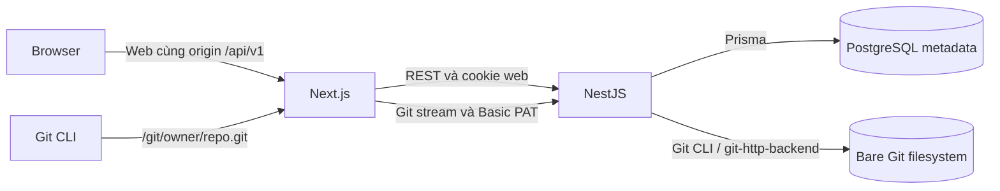

# 02 — Kiến trúc và công nghệ

## Stack đang dùng

Phiên bản dưới đây lấy từ manifest, không phải khẳng định phiên bản thực tế đã cài trên mọi máy; `pnpm-lock.yaml` xác định dependency khi cài frozen lockfile.

| Thành phần | Công nghệ | Vai trò |
| --- | --- | --- |
| Workspace | TypeScript, pnpm 12.3.4, Corepack | Monorepo frontend/backend |
| Frontend | Next.js 16.3.4 App Router, React 19.2.8 | Web, server rendering và Route Handler proxy |
| Giao diện | CSS variables, CSS Modules, React Context | Light theme tiếng Việt, responsive, session state |
| README | react-markdown 10, remark-gfm 4 | Render Markdown/GFM có kiểm soát |
| Backend | NestJS 11, Express adapter | REST, auth, policy và Git HTTP |
| Input | class-validator, class-transformer | DTO validation |
| Auth | JWT, cookie-parser, Argon2, Nest throttler | Access/refresh, password hash, rate limit hiện có |
| Database | PostgreSQL 17 local, Prisma 6.19 | Metadata và migration |
| Git | Git CLI, bare repository, git-http-backend | Source, lịch sử và Smart HTTP |
| Local/container | Docker Compose, Dockerfile nhiều stage, Node 24 image | PostgreSQL, backend và Git volume |
| Kiểm thử | Jest 29, Playwright/Chromium | Unit, HTTP integration, browser và full-stack |
| Chất lượng | ESLint, TypeScript typecheck, build | Gate trước tích hợp |

Vercel/Render/Neon là **hướng triển khai M8**, chưa phải bằng chứng đã có deployment hoạt động. Không cần tài khoản cloud để chạy local.

## Luồng hệ thống

Browser gọi các Route Handler cùng origin; Next server dùng `BACKEND_URL` để gọi Nest. Cookie HttpOnly thuộc origin frontend; mutation web kiểm tra Origin tại proxy/backend. Một số Server Component đọc backend trực tiếp từ server.

Git CLI local dùng URL `/git/{owner}/{repo}.git` qua Next proxy; production clone URL được cấp bằng `GIT_PUBLIC_BASE_URL` và trỏ trực tiếp tới `/api/v1/git/...` trên backend để tránh giới hạn body của Vercel Functions. Backend kiểm tra PAT, scope, quyền và trạng thái repo trước khi gọi Git. `upload-pack` phục vụ clone/fetch; `receive-pack` hỗ trợ push với ref/quota validation.

Database và filesystem không cùng một transaction. Khi tạo, xóa, reset storage hoặc sau này merge, phải tính tình huống một bên thành công còn bên kia thất bại; không chỉ xử lý happy path.

## Dữ liệu hiện có và dữ liệu dự kiến

| Model trong Prisma hiện tại | Ý nghĩa |
| --- | --- |
| User | Tài khoản, password hash, system role, trạng thái |
| Session | Refresh token hash, family, expiry và revoke |
| Repository | Owner, tên, visibility/status, default branch, storageKey/generation, soft-delete |
| RepositoryMember | Khóa ghép repositoryId/userId, quyền READ/WRITE |
| PersonalAccessToken | Prefix/hash, scopes dạng String[], hạn dùng và revoke |
| AuditLog | actorId, action, targetId, createdAt; actorId hiện không khai báo foreign key |

`Invitation`, `PullRequest` và `PullRequestMergeOperation` có trong [schema hiện tại](backend/prisma/schema.prisma); hỗ trợ vòng đời lời mời, PR và reconciliation merge. AuditLog lưu allowlisted metadata; không lưu secret hoặc source/diff.

Commit/tree/blob/branch được đọc từ Git, không có bảng lưu bản sao toàn bộ source. Storage dùng key UUID, không ghép trực tiếp owner/tên repo thành đường dẫn filesystem. `RepositoryStatus` hiện chỉ có ACTIVE/LOCKED/DELETED; trạng thái provisioning/failure trong activity là mô tả quy trình, không phải enum đang tồn tại.

## Bản đồ source để bắt đầu đọc

| Đường dẫn | Việc cần hiểu |
| --- | --- |
| [package.json](package.json), [workspace](pnpm-workspace.yaml) | Scripts root và phiên bản pnpm |
| [backend/src/main.ts](backend/src/main.ts), [app.module.ts](backend/src/app.module.ts) | Khởi động Nest, middleware/module |
| [backend/src/config/environment.ts](backend/src/config/environment.ts) | Cấu hình được validate và default |
| [backend/src/auth](backend/src/auth), [users](backend/src/users) | Session, guards, normalize, public profile |
| [repository.policy.ts](backend/src/repositories/repository.policy.ts) | Quyền đọc/quản lý tập trung |
| [repositories.controller.ts](backend/src/repositories/repositories.controller.ts), [service](backend/src/repositories/repositories.service.ts) | REST metadata, source, quota số repo, transaction |
| [git-storage.service.ts](backend/src/repositories/git-storage.service.ts) | Tạo bare, đọc source, validation, giới hạn và reset |
| [git-http.service.ts](backend/src/repositories/git-http.service.ts) | PAT authorization, CGI/stream, timeout/cancel/log |
| [repository-purge.service.ts](backend/src/repositories/repository-purge.service.ts) | Purge repo hết retention |
| [backend/src/tokens](backend/src/tokens) | Tạo/list/revoke PAT và audit |
| [backend/prisma](backend/prisma) | Schema và migration là lịch sử dữ liệu cần giữ |
| [frontend/src/app](frontend/src/app) | Routes, pages, API proxy và Git proxy |
| [frontend/src/components](frontend/src/components), [lib](frontend/src/lib) | UI, auth provider và client/helper |
| [backend/test](backend/test), [frontend/test](frontend/test) | HTTP và browser harness; unit nằm cạnh backend source |
| [compose.yaml](compose.yaml), [Dockerfile](backend/Dockerfile) | Local infrastructure và image backend |

`packages/*` vẫn chưa có thư mục riêng trong workspace; shared contracts hiện được tích hợp theo module/API. `.github/workflows/ci.yml` có hosted gate cho unit, PostgreSQL/Git E2E, browser/full-stack, Docker image và migration. CI không thay thế smoke test cloud.

Trong checkout hiện tại không có `frontend/AGENTS.md`; trước khi sửa frontend, kiểm tra lại chỉ dẫn repository và đọc tài liệu Next phù hợp phiên bản dependency.

## Những ràng buộc kỹ thuật cần bảo toàn

- Không gọi shell bằng chuỗi chứa input người dùng; truyền Git arguments tách biệt, validate path/ref và giới hạn output/time.
- Không đọc source trước khi kiểm tra policy; không cache công khai nội dung private.
- Code viewer hiển thị text; Markdown bỏ HTML nguy hiểm, không phục vụ SVG/raw HTML như ảnh source.
- Request Git kiểm tra quyền mới; stream có timeout/cancellation và giới hạn số process mỗi instance.
- Ghi log có allowlist, không log PAT/password/Cookie/Authorization hoặc source private.
- Khi bổ sung push/merge, kiểm tra quota và ref trước khi cập nhật; merge dùng expected SHA, lock và compare-and-swap, có reconciliation khi DB/Git lệch nhau.
