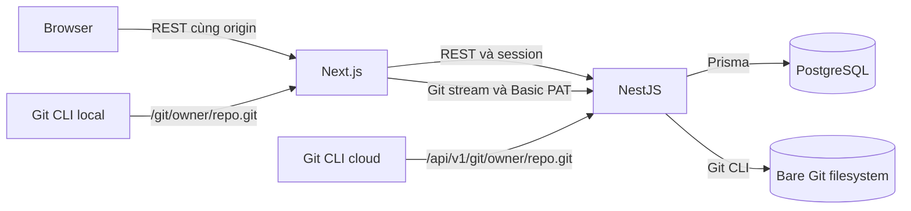

# 02 — Kiến trúc và công nghệ

## Stack

Phiên bản theo manifest; `pnpm-lock.yaml` quyết định dependency khi cài frozen lockfile.

| Thành phần | Công nghệ |
| --- | --- |
| Workspace/runtime | pnpm 12.3.4, Corepack, Node 24, TypeScript |
| Frontend | Next.js 16.3.4 App Router, React 19.2.8, CSS Modules/CSS variables, Context |
| Markdown | react-markdown 10, remark-gfm 4 |
| Backend | NestJS 11, Express, class-validator/class-transformer |
| Auth | JWT, refresh session, Argon2, cookie-parser, throttler; PAT cho Git |
| Metadata | PostgreSQL 17 local, Prisma 6.19 |
| Source | Git CLI, bare repo, git-http-backend và pre-receive hook |
| Verification | Jest 29, Playwright Chromium, ESLint, TypeScript, build/Docker/migration gates |

## Luồng dữ liệu

`BACKEND_URL` là origin Nest, không gồm `/api/v1`. Browser gọi proxy Next; Server Components có thể đọc API trực tiếp. Private data không được cache công khai. Mutation kiểm tra Origin; proxy ký IP bằng secret dùng chung để backend phân bucket rate limit.

`GIT_PUBLIC_BASE_URL` quyết định clone URL: local qua Next, cloud trực tiếp backend để tránh giới hạn proxy frontend. Auth/policy kiểm tra trước khi đọc source hoặc mở Git process.

## Mô hình dữ liệu

| Model | Vai trò |
| --- | --- |
| User, Session | Tài khoản/avatar/system role; refresh family, expiry/revoke |
| Repository | Owner, visibility/status, default branch/protection, storageKey/generation, soft-delete |
| RepositoryMember, Invitation | READ/WRITE, `canMerge`; vòng đời lời mời |
| PersonalAccessToken | Prefix/hash, scopes, expiry/revoke; plaintext chỉ trả lúc tạo |
| PullRequest | Branches, tác giả, trạng thái/version, metadata merge |
| PullRequestMergeOperation, GitPushOperation | Journal cho ghi Git và đối soát khi DB/Git lệch nhau |
| BranchUpdate | Actor xác thực, branch/SHA/generation phục vụ activity |
| AuditLog | Metadata allowlist; không lưu token/source/diff; actorId không khai báo foreign key |

Branch/tree/blob/commit đọc từ Git, không sao chép toàn bộ source vào DB. Storage dùng UUID key. DB và Git không chung transaction: ghi journal, dùng advisory lock và expected SHA; chỉ hoàn tất metadata khi có bằng chứng. Xem [recovery contract](van-hanh/khoi-phuc-thao-tac-git.md).

## Bản đồ source

| Đường dẫn | Nội dung |
| --- | --- |
| `backend/src/main.ts`, `app.module.ts`, `config/environment.ts` | Bootstrap, modules, validate/default env |
| `backend/src/auth`, `users`, `tokens` | Session/account, profile, PAT |
| `backend/src/repositories/repository.policy.ts` | Quyền đọc/ghi/quản lý repo |
| `backend/src/repositories/repositories.*`, `pull-requests.*` | Metadata/source API, invitations/members, PR và merge |
| `backend/src/repositories/git-storage.service.ts`, `git-http.service.ts`, `pre-receive-hook.cjs` | Git, stream, cancel, ref/quota validation |
| `backend/src/maintenance`, `admin`, `release-control` | Cleanup/reconciliation, admin, write-freeze/drain |
| `backend/prisma/schema.prisma`, `migrations/` | Schema và lịch sử migration |
| `frontend/src/app`, `components`, `lib` | Routes/proxy, shared UI, session/API helpers |
| `backend/test`, `frontend/test`, `frontend/test-fullstack` | HTTP integration, browser fixture, full-stack thật |
| `compose.yaml`, `backend/Dockerfile`, `backend/Dockerfile.migrate` | Local services và hai image triển khai |
| `.github/workflows/ci.yml` | Gate tích hợp đầy đủ |

## Ràng buộc

- Truyền Git arguments tách biệt; validate path/ref, giới hạn thời gian/output/quota và số process. Tín hiệu đã hủy phải được kiểm tra trước khi spawn Git.
- Giữ source/diff escaped; Markdown không render HTML nguy hiểm; không phục vụ SVG/raw HTML như ảnh source.
- Web policy và PAT scope đều bắt buộc; ADMIN không bypass private/merge policy.
- Production khởi động frozen (`WRITE_FREEZE_BOOTSTRAP=true`); admin kiểm tra drain trước migration/deploy.
- Không sửa migration đã áp dụng, không reset dữ liệu để qua kiểm tra. Đọc [CONSTRAINTS](../CONSTRAINTS.md) và chỉ dẫn agent trước khi sửa.
