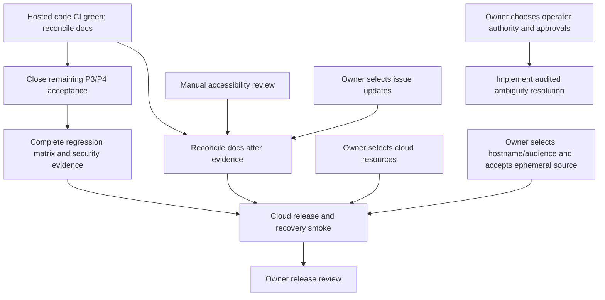

# Code Forge — remaining task plan

## Current release gates (2026-10-26; older “Current” blocks below are historical)

- Current pushed code source/CI: `origin/thviet` is `7588c0a4306abf5309de2fe0cb8c6e0c93dac0e2`; Actions `MVP verification` #138 (`40276491886`) passed on that exact SHA. Local branch `codex/pr-operation-id-reuse` contains later test-only and documentation commits that are not in #138 and have not been pushed to `thviet`. A separate uncommitted worktree `codex/push-crash-proof` based on `700e346` now has a focused push process-crash test that passed 1/1 in Linux Docker; it is not hosted-CI evidence. This does not claim a Render deployment.
- Completed for the BTL demo: local full-stack owner/collaborator/PR journey, hosted CI #138 on source tip `7588c0a`, Render readiness/local-frontend→Render API, public anonymous clone/fetch, private PAT clone/push/fetch, owner PR merge/fetch and collaborator WRITE invite/accept/push/PR/owner-merge/fetch. Temporary PATs were revoked. Evidence is in the acceptance board, cloud checklist and task log.
- Cloud/release still partial: admin/audit cloud, payload/quota boundaries, migration, backup/restore and restart/source-loss recovery are unverified. Render Free storage may lose Git source on restart; historical P1001 cause remains unknown. Do not redeploy/restart as a “fix” without a source recovery plan.
- For the BTL demo, core API/Git owner-and-collaborator flow is verified; a local 375×812 check confirmed the storage warning is visible without horizontal overflow, and admin bootstrap CLI E2E passed 5/5 on an isolated DB. Optional browser-driven PR presentation is not claimed. Broader P3/P4 recovery matrix and issue #6's operator-resolution policy remain open; Vercel is out of scope.
- Do not mark P0–P8 complete from a green CI run alone; the BTL demo is usable before every production/recovery gate is closed.

Older “Current” paragraphs below are historical snapshots and must not override this section.

**Historical source/CI state (2026-10-25):** `thviet` and `origin/thviet` pointed to exact SHA `94ceb6fdb090c1632c53de0ec96e8a975f9a265d`. Compare concurrency was capped at 2 per process and rate-limited to 10/IP/minute; a regression test verified the third concurrent request was rejected before lock acquisition. Local checks passed: backend unit 17 suites/116 tests, backend lint/typecheck, frontend lint/typecheck, Git-storage real tests 21/21. CI for this SHA had not been checked. Workflow #68 / `40169475724` failed on predecessor `be99b55` at backend lint (`git-storage.service.spec.ts:260`, `no-unsafe-assignment`), fixed in `045f5c1`; it did not establish current-SHA status. The 3.8 AGY audit timed out after 90s; Gemini4 fallback had unsupported flags and no completed review. A human security subagent identified moderate DoS risk; mitigation was committed. Cloud release remained unverified.

**Evidence baseline:** branch `thviet`; latest pushed code SHA is `24e6abc69cb947d575306134c362491bc96c93ad`, after fixes in `896575c` (repository-lock cleanup), `45cb1f4` (admin focus restoration), and `24e6abc` (AGY effort tiers). Hosted run `40167861108` succeeded in 5m32s on that exact SHA. Historical run `40166811302` remains FAILED on old SHA `1209bca8cde9e3f594c6dc44036426a9e73f7ea6`: backend unit/E2E, lint, typecheck, and build passed; frontend Playwright had 51 passed / 1 failed because Escape did not restore focus to “Khóa tài khoản”; later full-stack, Docker image/migration, and diff-whitespace steps were skipped. New local evidence: backend unit 17 suites/113 tests; workspace typecheck, lint, build; focused lock spec 3/3; frontend Playwright 52/52; and full-stack Playwright 3/3 all passed. The full-stack run used the dedicated existing `codeforge-merge-crash-test` PostgreSQL DB `code_forge_test` on loopback port 49588; only its random schema and temp Git root were created/cleaned, with no Docker volumes reset/deleted. Candidate images `code-forge-api:codex-local-20261025` and `code-forge-migrate:codex-local-20261025` built and passed local content smoke (Git 2.39.5, executable pre-receive hook, Prisma client in API; Prisma 6.19.3 and Prisma client resolution in migration image); no migration was applied and no volumes were reset/deleted. The separate PR-specific E2E was refused by its `_test` safety guard because `backend/.env` points to a non-test DB; it is neither a test failure nor an integration result. Code fixes are pushed; Markdown consolidation/status edits remain local, uncommitted, and unpushed, and were not part of the successful hosted SHA. Hosted CI is green, but cloud release remains unverified. Codex, Nemotron Ultra, and one AGY read-only review using `claude-sonnet-5-5-medium` reported no blocking finding in scope. Gemini 3.8 Flash broad-review calls timed out and are not counted as audit passes; a separate scoped Gemini 4 Argon Medium review of exactly two test diffs completed in about 40 seconds with no actionable findings, and AGY did not run tests. User reports Gemini 3.8 quota resets hourly and Gemini 4 Argon quota resets weekly; optimize 3.8 first. The wrapper now defaults to Gemini 3.8 Flash Medium; use Gemini 4 Argon Medium via `-Family gemini-4-argon` only after a scoped 3.8 timeout. The earlier Gemini 4-default wrapper smoke (`AGY_GEMINI4_WRAPPER_OK`, exit 0) predates the latest default change and does not verify current model selection.

**Latest verification update:** for `94ceb6f`, backend unit is 17 suites / 116 tests; backend lint/typecheck, frontend lint/typecheck, and Git-storage real tests 21/21 passed. Compare concurrency is capped at 2 per process and 10/IP/minute at the endpoint; the third-request test confirms rejection before lock acquisition. Current hosted CI has not been checked. Run #68 (`40169475724`) failed on predecessor `be99b55` only at backend lint line 260 (`no-unsafe-assignment`), corrected in `045f5c1`; do not transfer that failure or assume a pass for `94ceb6f`. Cloud release remains unverified.

AGY selection follows the user's quota preference: Gemini 3.8 first; Claude families only when intentionally selected/available; Gemini 4 as explicit fallback after a scoped 3.8 timeout and observed Claude quota error. No quota-balance field is exposed, so do not pre-check quota.

This is an execution register, not a completion claim. P0–P8 acceptance remains governed by `docs/implementation-status.md`, `docs/remaining-work-breakdown.md`, and `docs/deployment/cloud-smoke-checklist.md`.

## Owner-only decisions and actions

Do not paste credentials or secret values into chat. Codex can continue local work while these choices are pending, but cloud release and ambiguous-journal resolution cannot be finalized without the relevant decisions.

| ID | Priority | Owner action | Done when |
| --- | --- | --- | --- |
| U1 | CI failure diagnosis | Current crash-test logs and run `40166811302` were inspected. That historical run failed at the admin-dialog focus-restoration assertion; the code fix is now pushed and replacement run `40167861108` passed on exact SHA `24e6abc69cb947d575306134c362491bc96c93ad`. Earlier unrelated runs `40160123068` / `40159331450` remain optional historical diagnosis; do not send a password, OTP, or token in chat. | Crash-test root cause and backend fix are recorded; historical failure remains distinct from current green hosted CI. |
| U2 | Required for cloud | Confirm authorized Render/Neon resources and account sessions. Vercel is deferred/out of scope per the current owner objective and is not a release prerequisite. Keep credentials only in provider dashboards/Codex secret storage. | Render/Neon resource identities and authorized sessions are available without exposing secrets in chat or repository. |
| U3 | Required for cloud | Choose the canonical demo hostname and intended audience; explicitly accept that free Render Git storage can lose source on sleep, restart, or redeploy while database metadata remains. | Hostname/audience and source-loss acceptance are recorded; product warning and restore procedure are reviewed. |
| U4 | Required before operator-resolution design | Decide whether the existing `ADMIN` role may resolve ambiguous journals or a distinct operator role is required; decide whether one operator or two-person approval is required. | Security contract is explicit before schema/API/UI implementation. Until then, keep ambiguous journals fail-closed and do not perform manual repair. |
| U5 | Release review | Review the cloud smoke checklist, source reset/recovery behavior, and rollback instructions before sharing any demo URL. | Owner confirms the limitations and release evidence are understood. |
| U6 | Optional issue updates | After current evidence is verified, select issue #3, #4, #5, #6, or none for a comment/update. | Live issue state is rechecked and only explicitly selected comments are posted; Issue #6 already exists and is not a draft awaiting creation. |

## Codex-led tasks

| ID | Priority | Owner | Work and dependency | Acceptance evidence |
| --- | --- | --- | --- | --- |
| C1 | P3/P4/P7 | Codex + Linux CI | Historical run `40166811302` remains FAILED on old SHA `1209bca8cde9e3f594c6dc44036426a9e73f7ea6`, where frontend Playwright was 51/52 at the admin focus assertion. Fixes are pushed in `896575c`, `45cb1f4`, and `24e6abc`; hosted run `40167861108` succeeded in 5m32s on exact SHA `24e6abc69cb947d575306134c362491bc96c93ad`. Current documentation reconciliation was not in that run. | Hosted CI acceptance for this SHA is complete; preserve the old failure as historical evidence and keep cloud/P3/P4 remaining work separate. |
| C2 | P3/P4 | Codex lead + backend test agent | Root cause 1: test deadlocked its own proof by waiting on a PG session before releasing the advisory barrier. Root cause 2: global registration throttling limited one test client to five requests/minute. Fixes are test-only in `b191165` and `1209bca`; backend E2E passed on `1209bca` in run `40166811302`. Latest unit suite is 17 suites/114 tests; workspace gates, frontend/full-stack, and focused tests pass. The full PR E2E suite passed 6/6 on isolated tmpfs-only PostgreSQL; its merge crash/restart test was skipped on Windows. New uncommitted local Linux Docker test on `codex/push-crash-proof` proves the separate push crash window before durable `GIT_CHILD_SUCCEEDED` proof (1/1); hosted CI is pending. Earlier `_test`-guard refusal on non-test `.env` was a safe block and is superseded by that isolated pass. Git storage suite passed 20/20, including unrelated-history `NO_MERGE_BASE` with refs unchanged. AGY default Gemini 3.8 Medium reviewed only `git-storage.service.spec.ts` and returned `NO_ACTIONABLE_FINDING`. Larger two-test PR slice timed out at 45s on Gemini 3.8 and 60s on one Gemini 4 fallback; neither produced usable findings or an audit pass. Earlier successful Gemini 4 review covered PR lifecycle and then-current Git compare tests only, not later storage-reset E2E. Do not use `pg_terminate_backend` as success-path proof. | Keep hosted evidence distinct from local-only coverage while closing remaining P3/P4 acceptance cases. |
| C3 | P3/P4/P7 | Codex QA + security reviewer | Repository-lock service fix was reproduced RED, reviewed by Codex, Nemotron Ultra via Continue CLI, and AGY read-only `claude-sonnet-5-5-medium` without blocking findings, then committed/pushed as `896575c`. Hosted run `40167861108` succeeded in 5m32s on exact SHA `24e6abc69cb947d575306134c362491bc96c93ad`; CI is green, while cloud acceptance and the remaining P3/P4 matrix remain open. The new push pre-proof crash case passed locally on Linux Docker only; no hosted run has verified it. Gemini 3.8 Flash timed out and is not counted; separate Gemini 4 Argon smoke only proves response, not review. | Reconcile remaining P3/P4 failure matrix against real PostgreSQL/Git evidence; no mock or DB-trigger-only test is described as a process crash. |
| C4 | P6 | Codex + security reviewer | After U4, define and implement a bounded, audited workflow for permanently ambiguous/cross-type journals. Until then preserve the current runbook and fail-closed behavior. | Authorization, evidence rules, concurrency/revision checks, immutable/idempotent audit, unknown-state fencing, and negative/positive PostgreSQL tests meet the approved contract. No manual SQL/ref repair. |
| C5 | P0/P7 | Codex lead | Reconcile acceptance board, implementation ledger, task log, issue records, and release docs to successful run `40167861108`. The current Markdown updates were not in that run and remain local. Issue #6 tracks audited ambiguous-journal resolution; ADMIN/operator and one/two-approver choices remain owner decisions. | Every claim names commit, environment, command/run, and observed result; cloud, screen-reader/manual review, and owner decisions remain visibly open where unverified. |
| C6 | P5/P7 | Codex QA | Perform remaining manual accessibility checks that are available locally; record screen-reader/device work that needs a human or physical device. | Keyboard/focus and responsive browser results are recorded; no screen-reader or physical-device claim without direct observation. |
| C7 | P2/P8 | Codex release + owner | After U2/U3 and local/hosted acceptance, configure Render/Neon (Vercel deferred/out of scope), rehearse metadata backup/restore and additive migration, then run the cloud checklist. | Evidence covers direct Render Git HTTPS (including >4.5 MB), auth/private/public, cold start, source loss and restoration from local clone, PR/admin journeys, TLS/proxy behavior, backup/restore, and rollback on the release commit. |

## Dependency order

## Current stop conditions

- Current hosted CI is Actions `MVP verification` #138 (`40276491886`), successful on exact pushed SHA `7588c0a4306abf5309de2fe0cb8c6e0c93dac0e2`. Older failure `40166811302` and replacement `40167861108` remain historical evidence, not the current baseline.
- Local commits after `origin/thviet` include push-journal fail-closed/idempotency and concurrent-reconciliation coverage, cross-repository merge operation-ID coverage, and expired admin-restore boundary coverage; their focused local results are recorded in T27–T31 and are not hosted CI evidence. Do not claim these local changes are pushed or deployed.
- The latest verified Render deployment remains `388c584`. Do not push/redeploy/migrate until a tested write-freeze/drain and Git-source plus metadata recovery rehearsal are available; the README and operator runbook explicitly hard-stop without those safeguards.
- Existing local E2E refusals due to a non-test `backend/.env` remain historical; current focused PostgreSQL/Git tests use the isolated `_test` database/schema and temp storage. Keep test, CI, and cloud evidence distinct.
- Do not resolve ambiguous journals or weaken write fencing before U4 and the security contract are approved.
- Do not deploy, publish a demo URL, or claim source durability before U2/U3, the cloud smoke checklist, and owner review.
- Do not post issue comments without U6; first recheck issue state and refresh these drafts against current evidence.
- Never reset or migrate existing development/cloud databases or delete existing Docker volumes as a shortcut.
