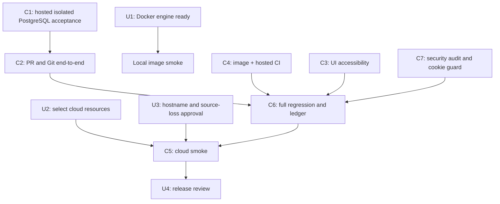

# Code Forge — remaining task plan

Baseline: branch `thviet`, latest pushed code commit `d1019a2`. Last fully passing hosted revision is `7e0aa27` (run `40138087574`); latest attempt `40139229848` failed at backend E2E step 12, but unauthenticated GitHub output does not reveal the specific test/stack trace. This is a task register, not a completion claim. P0–P8 acceptance remains governed by `implementation-status.md` and `deployment/cloud-smoke-checklist.md`.

## Tasks for the owner

These are the few items that require your machine, account, or product decision. Do not paste credentials or secret values into chat.

| ID | Priority | Owner | Action | Done when |
| --- | --- | --- | --- | --- |
| U1 | Required for local image smoke | You | Docker Desktop remains at “Turning off the Docker Engine…”; `docker version` does not return promptly and PostgreSQL is not listening at `localhost:5433`. When ready, start/recover the engine yourself, then from PowerShell run `docker info` and `docker ps`. Do not reset containers or volumes. | Both commands return promptly and show the expected engine. Then ask Codex to resume local image smoke. Hosted CI has its own disposable PostgreSQL and can proceed independently. |
| U2 | Required for cloud | You | Confirm which GitHub/Vercel/Render/Neon accounts and project should host the demo. Create or select the three cloud resources, but keep secrets in provider dashboards/Codex secret storage. | We have the project/resource identifiers and authorized account sessions, not secret values in chat. |
| U3 | Required for cloud | You + Codex | Agree the public demo hostname and who may access it. The agreed demo uses ephemeral Git storage: source may disappear on service restart/redeploy/sleep, while metadata persists. | Hostname/access decision recorded; the source-loss warning is visible and accepted before public release. |
| U4 | Release review | You | Review the final smoke checklist and recovery instructions before sharing the demo URL. | Checklist and reset/recovery behavior are understood. |

## Tasks Codex and agents will execute

| ID | Priority | Owner | Work | Acceptance |
| --- | --- | --- | --- | --- |
| C1 | P0/P1/P6 | Codex + backend agent | Hosted CI runs isolated PostgreSQL migrations, admin bootstrap CLI, auth/repository/invitation integration, and admin audit/restore tests. Fixture refuses non-loopback or non-`*_test` URLs. | Run `40136064222` passes migrations, CLI stdin secrecy, bootstrap create/promote audit, selected HTTP integration, and the concurrent refresh-reuse E2E. Upgrade-from-production snapshot remains release-specific. |
| C2 | P3/P4/P7 | Codex + backend test agent | First obtain the E2E stdout for run `40139229848` or reproduce its failing case; do not guess based on the 23-second duration. Then verify the new post-ref-update DB failure/reconciliation path on `d1019a2`, including `mergedById=actorId`, single reconciliation audit, two Git parents and idempotent retry. Continue only with uncovered conflict/stale/quota/lifecycle cases. | The exact failing test is named and corrected with evidence; `backend test:e2e` passes in isolated PostgreSQL/Git CI on the exact fix commit. New recovery case shows no second ref movement/audit on retry. |
| C3 | P5/P7 | UI agent | Audit and improve PR UI keyboard, screen-reader, error, and narrow-screen behavior. Keep the current CSS token system. | Hosted browser suite passes 48/48 on `db2041d`, including 375px long labels/diff, keyboard focus, and 503/retry recovery. Broader screen-reader and manual viewport checks remain. |
| C4 | P0/P8 | Infra agent + Codex | Audit/fix Docker runtime and migration images, run image smoke, and verify the hosted GitHub Actions workflow. | Hosted image/content checks, migration deploy, and Compose backend-config validation pass on `d2577fb` (run `40137272731`). `compose.yaml` binds DB/API ports to loopback and supplies required local-only settings. Local container startup/image smoke remains unverified because Docker Engine commands do not respond. |
| C5 | P2/P8 | Codex + you | Configure Vercel/Render/Neon, run direct Render Git HTTPS tests and release smoke. | Clone/fetch/push (including >4.5 MB payload), auth, proxy-aware rate limits from distinct clients, spoofed-header rejection, cold start, restart/reset, PR, admin, and recovery checklist have evidence. |
| C6 | P7/P8 | Codex | Resolve the latest E2E failure, verify the production `COOKIE_SECURE` guard, rerun the full regression suite, update the acceptance ledger and release docs, and push each verified task batch to `thviet`. Prepare issue updates for #3/#4; post only after authenticated access is available and live state is verified. | New hosted run passes backend E2E, unit, lint, typecheck, build, browser/full-stack, Docker image/migration smoke and diff whitespace for the exact commit. Local backend unit now passes 14 suites/84 tests. |
| C7 | Before release | Security reviewer + Codex | Re-audit auth, repo permissions, Git protocol, PR merge/reconciliation, admin/audit controls and proxy-aware rate limits. Enforce and test `COOKIE_SECURE=true` in production config. | Read-only reviews found no confirmed exploitable auth/IDOR/RCE/admin/secret-logging issue. The conditional secure-cookie guard now passes its focused 8/8 environment suite; full CI remains pending. Cloud proxy-IP and direct Render Git behavior remain unverified. See `security-review-2026-10-25.md`. |

## Dependency order

## Current stop condition

The latest fully passing hosted revision is `40138087574` on `7e0aa27`; the newer run `40139229848` on `d1019a2` fails at backend E2E and its specific failing case remains unknown. The root overview documents were reconciled in `a6785c4`; no containers or volumes were altered. Remaining release blockers include identifying/fixing the E2E failure, verifying the new merge-reconciliation case and production secure-cookie guard, selecting authorized Vercel/Render/Neon resources and hostname/access policy, then testing direct Render Git and cloud reset/recovery. Docker Desktop is installed but currently stuck at “Turning off the Docker Engine…”; local PostgreSQL on port 5433 is unavailable. See `docs/remaining-work-breakdown.md` and `docs/issue-update-drafts.md` for task decomposition and prepared GitHub follow-up text.
