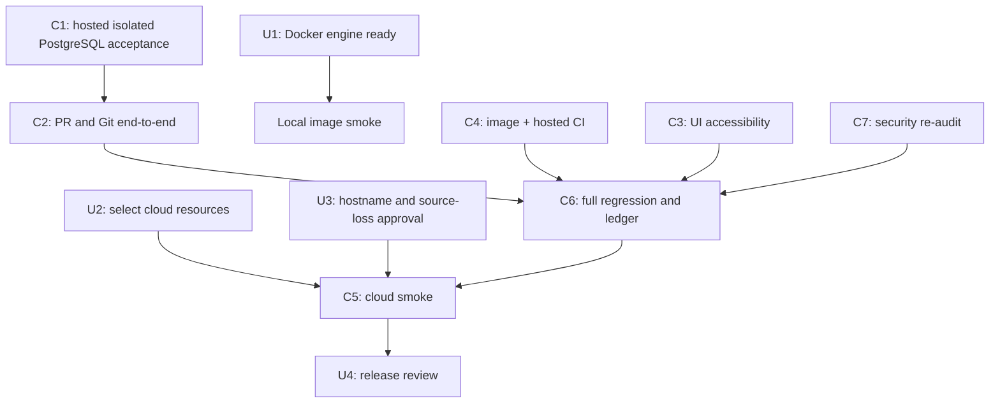

# Code Forge — remaining task plan

Baseline: branch `thviet`, latest verified commit `a22f0c8` (run `40133968613`). This is a task register, not a completion claim. P0–P8 acceptance remains governed by `implementation-status.md` and `deployment/cloud-smoke-checklist.md`.

## Tasks for the owner

These are the few items that require your machine, account, or product decision. Do not paste credentials or secret values into chat.

| ID | Priority | Owner | Action | Done when |
| --- | --- | --- | --- | --- |
| U1 | Required for local image smoke | You | Docker Desktop is installed; its current dashboard says the engine is `stopping`, and PostgreSQL is not listening at `localhost:5433`. When ready, start the engine yourself, then from PowerShell run `docker info` and `docker ps`. Do not reset containers or volumes. | Both commands return promptly and show the expected engine. Then ask Codex to resume local image smoke. Hosted CI has its own disposable PostgreSQL and can proceed independently. |
| U2 | Required for cloud | You | Confirm which GitHub/Vercel/Render/Neon accounts and project should host the demo. Create or select the three cloud resources, but keep secrets in provider dashboards/Codex secret storage. | We have the project/resource identifiers and authorized account sessions, not secret values in chat. |
| U3 | Required for cloud | You + Codex | Agree the public demo hostname and who may access it. The agreed demo uses ephemeral Git storage: source may disappear on service restart/redeploy/sleep, while metadata persists. | Hostname/access decision recorded; the source-loss warning is visible and accepted before public release. |
| U4 | Release review | You | Review the final smoke checklist and recovery instructions before sharing the demo URL. | Checklist and reset/recovery behavior are understood. |

## Tasks Codex and agents will execute

| ID | Priority | Owner | Work | Acceptance |
| --- | --- | --- | --- | --- |
| C1 | P0/P1/P6 | Codex + backend agent | Hosted CI runs isolated PostgreSQL migrations, admin bootstrap CLI, auth/repository/invitation integration, and admin audit/restore tests. Fixture refuses non-loopback or non-`*_test` URLs. | Run `40133968613` on `a22f0c8` passes migrations, CLI stdin secrecy, bootstrap create/promote audit, and selected HTTP integration. A new concurrent refresh-reuse E2E is in the current worktree and needs hosted isolated-DB verification. Upgrade-from-production snapshot remains release-specific. |
| C2 | P3/P4/P7 | Codex + PR test agent | Continue API-backed PR creation, compare, conflict/stale, merge, quota, default-branch, retry and reconciliation coverage. | Distinct-operation concurrent merge E2E passes on `9c2439b` (run `40135321075`). A new push–push real Git HTTP race test is in the uncommitted test batch; focused static checks pass, hosted E2E remains pending. Full push/merge, merge/delete/reset races, crash recovery, quota API matrix and reconciliation chaos remain. |
| C3 | P5/P7 | UI agent | Audit and improve PR UI keyboard, screen-reader, error, and narrow-screen behavior. Keep the current CSS token system. | Hosted browser suite passes 47/47 on `9c2439b`, including 375px long labels/diff and keyboard focus. The current local suite passes 48/48 with the new 503/retry recovery case; hosted CI pending. Broader screen-reader and manual viewport checks remain. |
| C4 | P0/P8 | Infra agent + Codex | Audit/fix Docker runtime and migration images, run image smoke, and verify the hosted GitHub Actions workflow. | CI image/content checks and migration deploy pass on `9c2439b` (run `40135321075`). `compose.yaml` binds DB/API ports to loopback and rendered config confirms it; local image smoke remains blocked because Docker Engine commands do not respond. |
| C5 | P2/P8 | Codex + you | Configure Vercel/Render/Neon, run direct Render Git HTTPS tests and release smoke. | Clone/fetch/push (including >4.5 MB payload), auth, proxy-aware rate limits from distinct clients, spoofed-header rejection, cold start, restart/reset, PR, admin, and recovery checklist have evidence. |
| C6 | P7/P8 | Codex | Run the complete regression suite, update acceptance ledger and deployment docs, then push each verified task batch to `thviet` and create follow-up issues for any remaining blockers. | Hosted run `40135321075` passes all standard gates on `9c2439b`. The current local diff adds concurrent refresh-reuse and push–push PostgreSQL/Git E2E tests plus PR retry browser coverage; workspace lint/typecheck, 82 backend unit tests and all 48 browser tests pass, but new PostgreSQL/Git E2E cases must be pushed and verified by a new CI run. Local PostgreSQL E2E was not run because port 5433 has no listener. |
| C7 | Before release | Security reviewer + Codex | Re-audit auth, repo permissions, Git protocol, PR merge/reconciliation, admin/audit controls and proxy-aware rate limits after fixes. | Read-only review found no confirmed exploitable auth/IDOR/RCE/admin/secret-logging issue. The PR proxy now enforces a tested 32 KiB body cap; the local Compose exposure was fixed. Cloud proxy-IP and direct Render Git behavior remain unverified. See `security-review-2026-10-25.md`. |

## Dependency order

## Current stop condition

The latest fully verified hosted code run is `40135321075` on `9c2439b`; docs-only run `40134420295` on `7bf51ec` also completed successfully. The current worktree passes workspace lint/typecheck, backend unit (14 suites / 82 tests), and frontend browser (48/48). It adds refresh-reuse and push–push PostgreSQL/Git E2E coverage, which remains unhosted because local PostgreSQL is unavailable. The four root-level overview documents remain user-owned, untracked, and untouched. Remaining release blockers include selecting authorized Vercel/Render/Neon resources and recording the public demo hostname/access decision (U2/U3), followed by direct Render Git and cloud smoke. Local PostgreSQL at `localhost:5433` is not listening and Docker Engine commands do not respond; Docker config can be rendered without the engine, but local image smoke remains unverified. No containers or volumes were altered.
