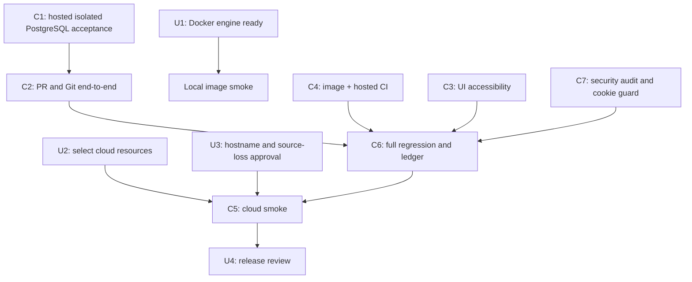

# Code Forge — remaining task plan

Baseline: branch `thviet`, latest pushed code commit `2305390`; full hosted workflow `40145289400` passed on that SHA. This is a task register, not a completion claim. P0–P8 acceptance remains governed by `implementation-status.md` and `deployment/cloud-smoke-checklist.md`.

## Tasks for the owner

These are the few items that require your machine, account, or product decision. Do not paste credentials or secret values into chat.

| ID | Priority | Owner | Action | Done when |
| --- | --- | --- | --- | --- |
| U1 | Required for local image smoke | You | Docker Desktop is open, but Docker Engine commands do not return promptly and PostgreSQL is not listening at `localhost:5433`. When ready, start/recover the engine yourself, then from PowerShell run `docker info` and `docker ps`. Do not reset containers or volumes. | Both commands return promptly and show the expected engine. Then ask Codex to resume local image smoke. Hosted CI has its own disposable PostgreSQL and can proceed independently. |
| U2 | Required for cloud | You | Confirm which GitHub/Vercel/Render/Neon accounts and project should host the demo. Create or select the three cloud resources, but keep secrets in provider dashboards/Codex secret storage. | We have the project/resource identifiers and authorized account sessions, not secret values in chat. |
| U3 | Required for cloud | You + Codex | Agree the public demo hostname and who may access it. The agreed demo uses ephemeral Git storage: source may disappear on service restart/redeploy/sleep, while metadata persists. | Hostname/access decision recorded; the source-loss warning is visible and accepted before public release. |
| U4 | Release review | You | Review the final smoke checklist and recovery instructions before sharing the demo URL. | Checklist and reset/recovery behavior are understood. |
| U5 | Optional issue updates | You | The authenticated Actions logs have been read and the drafts are current. Choose whether to post the prepared updates to issue #3, #4, both, or neither. Do not paste tokens or secrets into chat. | Only the issues you explicitly select receive a comment after their live open state is rechecked. |

## Tasks Codex and agents will execute

| ID | Priority | Owner | Work | Acceptance |
| --- | --- | --- | --- | --- |
| C1 | P0/P1/P6 | Codex + backend agent | Hosted CI runs isolated PostgreSQL migrations, admin bootstrap CLI, auth/repository/invitation integration, AdminController status/security and restore success/audit (`2305390`). Fixture refuses non-loopback or non-`*_test` URLs. | Run `40145289400` passes restore response/state/source-reset disclosure/audit assertions. Durable ordinary Git push audit remains open in issue #5; upgrade-from-production snapshot is release-specific. |
| C2 | P3/P4/P7 | Codex + backend test agent | Fixed double body consumption/API assertion defects in `0403bda`; same-operation concurrent merge replay has real PostgreSQL/Git coverage in `2955e36`; `2305390` adds a conflict/no-ref-movement scenario. Continue stale/quota/lifecycle cases. | Hosted `40145289400` verifies conflict returns 409 with unchanged target ref, OPEN PR, FAILED operation and no merge audit. |
| C3 | P5/P7 | Codex + UI reviewer | PR empty-state form focus and branch-list failure feedback are implemented; admin role/status/dialog coverage was added on `141f749`. | Local frontend lint/typecheck and Playwright 49/49 pass; hosted browser/full-stack gates pass on `2955e36` in `40144424454`. Screen-reader and broader manual viewport checks remain. |
| C4 | P0/P8 | Infra agent + Codex | Audit/fix Docker runtime and migration images, run image smoke, and verify the hosted GitHub Actions workflow. | Hosted image/content checks, migration deploy, and Compose backend-config validation pass on `d2577fb` (run `40137272731`). `compose.yaml` binds DB/API ports to loopback and supplies required local-only settings. Local container startup/image smoke remains unverified because Docker Engine commands do not respond. |
| C5 | P2/P8 | Codex + you | Configure Vercel/Render/Neon, run direct Render Git HTTPS tests and release smoke. | Clone/fetch/push (including >4.5 MB payload), auth, proxy-aware rate limits from distinct clients, spoofed-header rejection, cold start, restart/reset, PR, admin, and recovery checklist have evidence. |
| C6 | P7/P8 | Codex | Keep acceptance ledger/release docs current and push verified batches to `thviet`. Draft updates for #3/#4 remain unpublished pending explicit owner selection. Issue #5 tracks the P6 push-audit gap. | Hosted run `40145289400` passed on `2305390`. Local Docker/PostgreSQL remains unavailable for workstation smoke. |
| C7 | Before release | Security reviewer + Codex | Re-audit auth, repo permissions, Git protocol, PR merge/reconciliation, admin/audit controls and proxy-aware rate limits. Enforce and test `COOKIE_SECURE=true` in production config. | Read-only review at `a5739cd` found no confirmed exploitable auth/IDOR/RCE/admin issue, but found successful Git pushes lack durable actual-ref audit (tracked by issue #5). Earlier production secure-cookie tests/full CI pass; cloud TLS/proxy-IP and direct Render Git remain unverified. See `security-review-2026-10-25.md`. |

## Dependency order

## Current stop condition

The latest fully green code regression is `40145289400` on `2305390`. Remaining work includes durable Git push audit (#5), crash/quota/lifecycle cases, selecting authorized cloud resources/hostname/access policy, and testing direct Render Git and reset/recovery. Production secure-cookie validation and backend unit/lint/typecheck pass locally. Docker Desktop is open but its engine/PostgreSQL on port 5433 remain unavailable. See `docs/remaining-work-breakdown.md`, `docs/issue-update-drafts.md`, and issue #5 for task detail.
