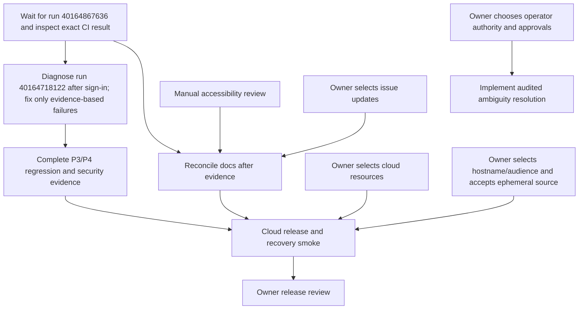

# Code Forge — remaining task plan

**Evidence baseline:** branch `thviet`, pushed commit `250ffdc`. This commit adjusts the Linux-only backend crash/restart E2E timeout to 180 seconds; the test targets a merge interrupted after the Git ref moves and before PR metadata commits. Backend typecheck and `git diff --check` passed before push; targeted ESLint still reports the pre-existing `await-thenable` at `backend/test/pull-requests.e2e-spec.ts:507`. The new E2E was not run locally. Public Actions metadata shows run `40164718122` for `e5eda1a` failed at `Run corepack pnpm --filter backend test:e2e:failure`; exact logs are not available yet, so the cause is unknown. Run `40164867636` for `250ffdc` is `in_progress`; no result is claimed. Crash/restart acceptance remains **pending**. The latest verified hosted green run remains `40162474987` on `9c2eb81`; that does not cover the new test or cloud release.

This is an execution register, not a completion claim. P0–P8 acceptance remains governed by `docs/implementation-status.md`, `docs/remaining-work-breakdown.md`, and `docs/deployment/cloud-smoke-checklist.md`.

## Owner-only decisions and actions

Do not paste credentials or secret values into chat. Codex can continue local work while these choices are pending, but cloud release and ambiguous-journal resolution cannot be finalized without the relevant decisions.

| ID | Priority | Owner action | Done when |
| --- | --- | --- | --- |
| U1 | CI failure diagnosis | Sign in to GitHub interactively and tell Codex to inspect detailed logs for failed run `40164718122` (and optionally historical runs `40160123068` / `40159331450`). Do not send a password, OTP, or token in chat. | The exact backend E2E failure is classified from its job log; until then, cause remains unknown and no speculative fix is made. |
| U2 | Required for cloud | Select or create the GitHub/Vercel/Render/Neon projects and authorize the relevant account sessions. Keep credentials only in provider dashboards/Codex secret storage. | Resource identifiers and authorized sessions are available without exposing secrets in chat or repository. |
| U3 | Required for cloud | Choose the canonical demo hostname and intended audience; explicitly accept that free Render Git storage can lose source on sleep, restart, or redeploy while database metadata remains. | Hostname/audience and source-loss acceptance are recorded; product warning and restore procedure are reviewed. |
| U4 | Required before operator-resolution design | Decide whether the existing `ADMIN` role may resolve ambiguous journals or a distinct operator role is required; decide whether one operator or two-person approval is required. | Security contract is explicit before schema/API/UI implementation. Until then, keep ambiguous journals fail-closed and do not perform manual repair. |
| U5 | Release review | Review the cloud smoke checklist, source reset/recovery behavior, and rollback instructions before sharing any demo URL. | Owner confirms the limitations and release evidence are understood. |
| U6 | Optional issue updates | After current evidence is verified, select issue #3, #4, #5, or none for an update. | Live issue state is rechecked and only explicitly selected comments are posted. All drafts remain unpublished until then. |

## Codex-led tasks

| ID | Priority | Owner | Work and dependency | Acceptance evidence |
| --- | --- | --- | --- | --- |
| C1 | P3/P4/P7 | Codex + Linux CI | Run `40164718122` on `e5eda1a` failed at `Run corepack pnpm --filter backend test:e2e:failure`. Run `40164867636` on `250ffdc` is `in_progress`. Await its terminal result, then inspect the exact job logs. | Record terminal result for exact SHA `250ffdc` and classify the failed E2E from logs. Current cause is unknown; do not infer it from the step name. |
| C2 | P3/P4 | Codex + backend test agent | Detailed diagnosis of `40164718122` awaits U1/sign-in. After obtaining logs, reproduce or isolate the concrete failure before making a scoped correction in a separate task/worktree. Do not use `pg_terminate_backend` as success-path proof. | Focused Linux E2E proves child API death after ref CAS, natural exit of its database sessions, replacement startup reconciliation, one audit, idempotent retry, and fetched two-parent merge. Typecheck, lint delta, and diff checks are recorded. |
| C3 | P3/P4/P7 | Codex QA + security reviewer | After C1 passes, reconcile the remaining failure matrix and security review against real PostgreSQL/Git evidence. Keep historical CI failures distinct from current failures. | Each required test is mapped to output on an identified commit; no mock or database-trigger-only test is described as a process crash. |
| C4 | P6 | Codex + security reviewer | After U4, define and implement a bounded, audited workflow for permanently ambiguous/cross-type journals. Until then preserve the current runbook and fail-closed behavior. | Authorization, evidence rules, concurrency/revision checks, immutable/idempotent audit, unknown-state fencing, and negative/positive PostgreSQL tests meet the approved contract. No manual SQL/ref repair. |
| C5 | P0/P7 | Codex lead + doc agent | Reconcile acceptance board, implementation ledger, task log, issue drafts, and release docs only after CI evidence for `250ffdc` is known. | Every claim names commit, environment, command/run, and observed result; cloud, screen-reader/manual review, and owner decisions remain visibly open where unverified. |
| C6 | P5/P7 | Codex QA | Perform remaining manual accessibility checks that are available locally; record screen-reader/device work that needs a human or physical device. | Keyboard/focus and responsive browser results are recorded; no screen-reader or physical-device claim without direct observation. |
| C7 | P2/P8 | Codex release + owner | After U2/U3 and local/hosted acceptance, configure Vercel/Render/Neon, rehearse metadata backup/restore and additive migration, then run the cloud checklist. | Evidence covers direct Render Git HTTPS (including >4.5 MB), auth/private/public, cold start, source loss and restoration from local clone, PR/admin journeys, TLS/proxy behavior, backup/restore, and rollback on the release commit. |

## Dependency order

## Current stop conditions

- Do not infer the cause of run `40164718122` from its failed step name; detailed logs await user sign-in.
- Do not call the crash/restart test accepted until run `40164867636` is complete and its hosted Linux evidence on `250ffdc` is inspected.
- Do not resolve ambiguous journals or weaken write fencing before U4 and the security contract are approved.
- Do not deploy, publish a demo URL, or claim source durability before U2/U3, the cloud smoke checklist, and owner review.
- Do not post issue comments without U6; first recheck issue state and refresh these drafts against current evidence.
- Never reset or migrate existing development/cloud databases or delete existing Docker volumes as a shortcut.
