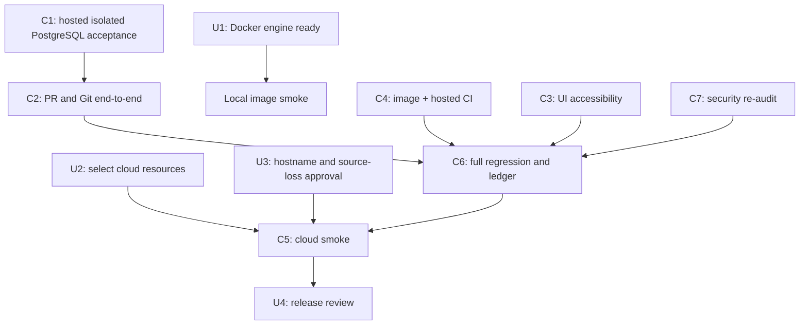

# Code Forge — remaining task plan

Baseline: branch `thviet`, commit `4a88d41`. This is a task register, not a completion claim. P0–P8 acceptance remains governed by `implementation-status.md` and the release checklist.

## Tasks for the owner

These are the few items that require your machine, account, or product decision. Do not paste credentials or secret values into chat.

| ID | Priority | Owner | Action | Done when |
| --- | --- | --- | --- | --- |
| U1 | Required for local image smoke | You | Docker Desktop is running, but the Docker CLI has been stalling and PostgreSQL is not listening at `localhost:5433`. Check the engine status in Docker Desktop; if it is stopped, start it. Then from PowerShell run `docker info` and `docker ps`. Do not reset containers or volumes. | Both commands return promptly and show the expected engine. Then ask Codex to resume local image smoke. Hosted CI has its own disposable PostgreSQL and can proceed independently. |
| U2 | Required for cloud | You | Confirm which GitHub/Vercel/Render/Neon accounts and project should host the demo. Create or select the three cloud resources, but keep secrets in provider dashboards/Codex secret storage. | We have the project/resource identifiers and authorized account sessions, not secret values in chat. |
| U3 | Required for cloud | You + Codex | Agree the public demo hostname and who may access it. The agreed demo uses ephemeral Git storage: source may disappear on service restart/redeploy/sleep, while metadata persists. | Hostname/access decision recorded; the source-loss warning is visible and accepted before public release. |
| U4 | Release review | You | Review the final smoke checklist and recovery instructions before sharing the demo URL. | Checklist and reset/recovery behavior are understood. |

## Tasks Codex and agents will execute

| ID | Priority | Owner | Work | Acceptance |
| --- | --- | --- | --- | --- |
| C1 | P0/P1/P6 | Codex + backend agent | Hosted CI now runs isolated PostgreSQL migrations, admin bootstrap CLI, auth/repository/invitation integration, and admin audit/restore tests. Reproduce locally after U1 if needed. | Fresh migrations, CLI stdin secrecy, bootstrap audit create/promote, and selected HTTP integration pass on commit `4a88d41` (run `40129005632`). Upgrade-from-production snapshot remains a release-specific check. |
| C2 | P3/P4/P7 | Codex + PR test agent | Continue API-backed PR creation, compare, conflict/stale, merge, quota, default-branch, retry and reconciliation coverage. | Main create/compare/owner-merge/replay journey passes hosted PostgreSQL E2E; full push/merge races, crash recovery, quota API matrix and reconciliation chaos remain. |
| C3 | P5/P7 | UI agent | Audit and improve PR UI keyboard, screen-reader, error, and narrow-screen behavior. Keep the current CSS token system. | Focused accessibility/browser tests pass; PR list/detail are checked at 375px and keyboard-only. |
| C4 | P0/P8 | Infra agent + Codex | Audit/fix Docker runtime and migration images, run image smoke, and verify the hosted GitHub Actions workflow. | CI image/content checks and migration deploy pass on `4a88d41` (run `40129005632`); local Docker Desktop image smoke remains useful but isn't a CI blocker. |
| C5 | P2/P8 | Codex + you | Configure Vercel/Render/Neon, run direct Render Git HTTPS tests and release smoke. | Clone/fetch/push (including >4.5 MB payload), auth, cold start, restart/reset, PR, admin, and recovery checklist have evidence. |
| C6 | P7/P8 | Codex | Run the complete regression suite, update acceptance ledger and deployment docs, then push each verified task batch to `thviet` and create follow-up issues for any remaining blockers. | Test evidence identifies commit/environment; no blocker is represented as passed; working tree and remote are reconciled. |
| C7 | Before release | Security reviewer + Codex | Re-audit auth, repo permissions, Git protocol, PR merge/reconciliation, admin and audit controls after fixes. | Findings include severity, exact location, patch/action, and retest evidence; no unresolved release-blocking finding. |

## Dependency order

## Current stop condition

The CI verification run is green on `4a88d41` (run `40129005632`), including PostgreSQL E2E, browser/full-stack tests, both Docker images, and migration deploy. Remaining release blockers are selecting authorized Vercel/Render/Neon resources and recording the public demo hostname/access decision (U2/U3), followed by cloud smoke. Local PostgreSQL at `localhost:5433` and local image smoke remain unavailable while Docker CLI stalls; Codex will not restart Docker Desktop or delete containers/volumes without a separate explicit request.
