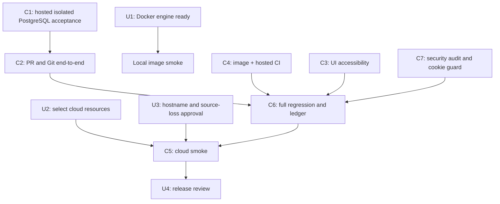

# Code Forge — remaining task plan

Baseline: branch `thviet`, latest pushed code commit `9c2eb81`. Hosted run `40162474987` passed all gates on that commit. Earlier runs `40160123068` and `40159331450` failed at backend E2E; exact causes remain unknown and GitHub sign-in is needed only to investigate those historical failures. Local backend E2E passed on isolated PostgreSQL. Maintenance grace unit/E2E and unique-project Compose runtime smoke also passed. This is a task register, not a completion claim. P0–P8 acceptance remains governed by `implementation-status.md`, `remaining-work-breakdown.md`, and `deployment/cloud-smoke-checklist.md`.

## Tasks for the owner

These are the few items that require your machine, account, or product decision. Do not paste credentials or secret values into chat.

| ID | Priority | Owner | Action | Done when |
| --- | --- | --- | --- | --- |
| U0 | Optional historical CI diagnosis | You | If you want the earlier CI failures explained, sign in to GitHub interactively and tell Codex to continue; do not send a password, OTP, or token in chat. | Codex can inspect runs `40160123068` / `40159331450`; this is not a blocker for the latest green workflow. |
| U1 | Local runtime smoke | Complete | Docker Engine responded after the requested wait. Unique-project Compose migration and readiness checks passed; a separate isolated PostgreSQL test container remains running. No existing container/volume was touched by the status check. | Local image/migration and Compose runtime smoke pass. |
| U2 | Required for cloud | You | Confirm which GitHub/Vercel/Render/Neon accounts and project should host the demo. Create or select the three cloud resources, but keep secrets in provider dashboards/Codex secret storage. | We have the project/resource identifiers and authorized account sessions, not secret values in chat. |
| U3 | Required for cloud | You + Codex | Agree the public demo hostname and who may access it. The agreed demo uses ephemeral Git storage: source may disappear on service restart/redeploy/sleep, while metadata persists. | Hostname/access decision recorded; the source-loss warning is visible and accepted before public release. |
| U4 | Release review | You | Review the final smoke checklist and recovery instructions before sharing the demo URL. | Checklist and reset/recovery behavior are understood. |
| U5 | Optional issue updates | You | After CI diagnosis, choose whether to post refreshed updates to issue #3, #4, both, or neither. Do not paste tokens or secrets into chat. | Only the issues you explicitly select receive a comment after their live open state is rechecked. |

## Tasks Codex and agents will execute

| ID | Priority | Owner | Work | Acceptance |
| --- | --- | --- | --- | --- |
| C1 | P0/P1/P6 | Codex + backend agent | `edb0ced` adds durable Git push journal/audit; `298fb62` fences unresolved merge journals and serializes login/refresh with admin account locks; `9f1eb0b` includes maintenance shutdown/test stabilization and branch byte-limit coverage. A conservative ambiguous-operation triage runbook is at `docs/operations/git-operation-recovery.md`. | Latest hosted run `40162474987` passes on `9c2eb81`; earlier backend E2E failures are historical and unexplained. Issue #5 stays open pending owner review and a supported resolution tool for permanently ambiguous rows. |
| C2 | P3/P4/P7 | Codex + backend test agent | Fixed double body consumption/API assertion defects in `0403bda`; same-operation concurrent merge replay has real PostgreSQL/Git coverage in `2955e36`; `2305390` adds a conflict/no-ref-movement scenario. Continue stale/quota/lifecycle cases. | Hosted `40145289400` verifies conflict returns 409 with unchanged target ref, OPEN PR, FAILED operation and no merge audit. |
| C3 | P5/P7 | Codex + UI reviewer | `6c921e5` adds a Playwright regression for background reconciliation announcement and merge SHA. | Latest hosted run `40162474987` passes frontend/browser gates. Screen-reader and physical-device review remain open. |
| C4 | P0/P8 | Codex | API/migration image and unique-project Compose runtime smoke pass; all 7 migrations applied and readiness returned 200. Hosted run `40162474987` passes all gates. | Local/hosted acceptance passes. Cloud release, backups and source recovery remain open; do not reset existing volumes. |
| C5 | P2/P8 | Codex + you | Configure Vercel/Render/Neon, run direct Render Git HTTPS tests and release smoke. | Clone/fetch/push (including >4.5 MB payload), auth, proxy-aware rate limits from distinct clients, spoofed-header rejection, cold start, restart/reset, PR, admin, and recovery checklist have evidence. |
| C6 | P7/P8 | Codex | Reconcile ledger and task cards to current evidence; push verified batches to `thviet`. Draft updates for #3/#4 remain unpublished pending exact historical CI logs and explicit owner selection. | Current pushed commit `9c2eb81`; hosted run `40162474987` passes all gates. Cloud release/reset recovery remains open; current documentation updates are uncommitted. |
| C7 | Before release | Security reviewer + Codex | Re-audit auth, repo permissions, Git protocol, PR merge/reconciliation, admin/audit controls and proxy-aware rate limits. Enforce and test `COOKIE_SECURE=true` in production config. | Static read-only audit found no confirmed actionable issue in reviewed code paths; the valid-pack lock-loss case passes on Linux and latest hosted CI. True backend process-crash/restart, ambiguous-journal resolution, cloud TLS/proxy-IP and direct Render Git remain unverified. See `security-review-2026-10-25.md` and `operations/acceptance-task-board-2026-10-25.md`. |

## Dependency order

## Current stop condition

Latest hosted run `40162474987` passed all workflow gates on `9c2eb81`; earlier backend E2E failures (`40160123068`, `40159331450`) remain unexplained but do not block current CI acceptance. Durable push audit, maintenance cleanup/idempotence, branch-byte boundaries, 120-second grace cases, and valid-pack lock-loss coverage are present. Remaining work includes true process-crash/restart acceptance, ambiguous-journal operator resolution, manual accessibility, and cloud deployment/recovery evidence. Local Compose runtime smoke passed. User-only choices remain cloud resources, hostname/audience, and explicit acceptance of ephemeral Git source storage; GitHub interactive login is optional if investigating historical logs. See `docs/operations/acceptance-task-board-2026-10-25.md`, `docs/implementation-status.md`, `docs/issue-update-drafts.md`, and `docs/operations/git-operation-recovery.md`.
