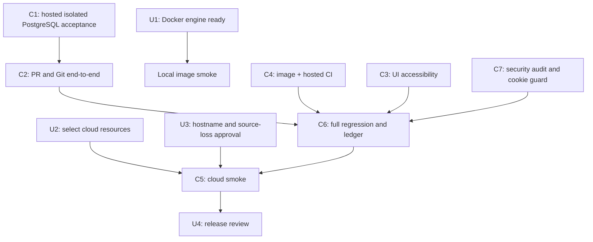

# Code Forge — remaining task plan

Baseline: branch `thviet`, latest pushed code commit `edb0ced`; hosted workflow `40147767567` succeeded. Local unit/build/full backend PostgreSQL-Git E2E acceptance passes on this SHA. This is a task register, not a completion claim. P0–P8 acceptance remains governed by `implementation-status.md` and `deployment/cloud-smoke-checklist.md`.

## Tasks for the owner

These are the few items that require your machine, account, or product decision. Do not paste credentials or secret values into chat.

| ID | Priority | Owner | Action | Done when |
| --- | --- | --- | --- | --- |
| U1 | Local runtime smoke | Complete | Docker Engine responds. Full backend E2E used a new volume-free PostgreSQL 17 container. API and migration images were built under commit-specific tags; the migration image applied all 7 migrations to a fresh DB and the API image returned readiness 200. Every temporary container was stopped/removed; no existing containers or volumes were changed. | Local image/migration runtime smoke passes. Compose runtime itself is not yet started. |
| U2 | Required for cloud | You | Confirm which GitHub/Vercel/Render/Neon accounts and project should host the demo. Create or select the three cloud resources, but keep secrets in provider dashboards/Codex secret storage. | We have the project/resource identifiers and authorized account sessions, not secret values in chat. |
| U3 | Required for cloud | You + Codex | Agree the public demo hostname and who may access it. The agreed demo uses ephemeral Git storage: source may disappear on service restart/redeploy/sleep, while metadata persists. | Hostname/access decision recorded; the source-loss warning is visible and accepted before public release. |
| U4 | Release review | You | Review the final smoke checklist and recovery instructions before sharing the demo URL. | Checklist and reset/recovery behavior are understood. |
| U5 | Optional issue updates | You | The authenticated Actions logs have been read and the drafts are current. Choose whether to post the prepared updates to issue #3, #4, both, or neither. Do not paste tokens or secrets into chat. | Only the issues you explicitly select receive a comment after their live open state is rechecked. |

## Tasks Codex and agents will execute

| ID | Priority | Owner | Work | Acceptance |
| --- | --- | --- | --- | --- |
| C1 | P0/P1/P6 | Codex + backend agent | Commit `edb0ced` adds the push journal schema/service, mutation gates, ref snapshotting, and audit-failure reconciliation. Local full backend E2E runs on a new loopback PostgreSQL 17 test database with temporary Git storage; admin bootstrap/restore cases remain covered. Hosted workflow `40147767567` succeeded. | Local E2E 8 suites/29 tests and hosted workflow pass on `edb0ced`. Issue #5 stays open pending owner review; operator handling for permanently ambiguous rows remains a release task. |
| C2 | P3/P4/P7 | Codex + backend test agent | Fixed double body consumption/API assertion defects in `0403bda`; same-operation concurrent merge replay has real PostgreSQL/Git coverage in `2955e36`; `2305390` adds a conflict/no-ref-movement scenario. Continue stale/quota/lifecycle cases. | Hosted `40145289400` verifies conflict returns 409 with unchanged target ref, OPEN PR, FAILED operation and no merge audit. |
| C3 | P5/P7 | Codex + UI reviewer | PR empty-state form focus and branch-list failure feedback are implemented; admin role/status/dialog coverage was added on `141f749`. | Local frontend lint/typecheck and Playwright 49/49 pass; hosted browser/full-stack gates pass on `2955e36` in `40144424454`. Screen-reader and broader manual viewport checks remain. |
| C4 | P0/P8 | Codex | Local API/migration images were built on `edb0ced`; migration applied 7 migrations to a disposable DB and API readiness returned 200. Hosted run `40147767567` succeeded. Compose config was validated, but Compose runtime itself was not started. | Image/migration smoke and hosted CI pass; Compose runtime acceptance remains; preserve all existing Compose volumes. |
| C5 | P2/P8 | Codex + you | Configure Vercel/Render/Neon, run direct Render Git HTTPS tests and release smoke. | Clone/fetch/push (including >4.5 MB payload), auth, proxy-aware rate limits from distinct clients, spoofed-header rejection, cold start, restart/reset, PR, admin, and recovery checklist have evidence. |
| C6 | P7/P8 | Codex | Keep acceptance ledger/release docs current and push verified batches to `thviet`. Draft updates for #3/#4 remain unpublished pending explicit owner selection. | Code commit `edb0ced` is pushed; hosted run `40147767567` succeeded. Cloud release/reset recovery remains open. |
| C7 | Before release | Security reviewer + Codex | Re-audit auth, repo permissions, Git protocol, PR merge/reconciliation, admin/audit controls and proxy-aware rate limits. Enforce and test `COOKIE_SECURE=true` in production config. | A second read-only review found no other confirmed push-audit race/attribution/privacy issue; terminal snapshots are cleared. Hosted CI is pending; permanent ambiguous journals still require an operator recovery workflow. Cloud TLS/proxy-IP and direct Render Git remain unverified. See `security-review-2026-10-25.md`. |

## Dependency order

## Current stop condition

The latest fully green hosted regression is `40147767567` on `edb0ced`; local unit/build/full backend E2E and Docker API/migration image smoke also pass on that commit. Durable push audit is implemented and host-verified; owner review and manual recovery/runbook remain. Cloud resources/hostname/access policy, direct Render Git, source reset/recovery, and Compose runtime smoke remain open. See `docs/remaining-work-breakdown.md`, `docs/issue-update-drafts.md`, and issue #5.
