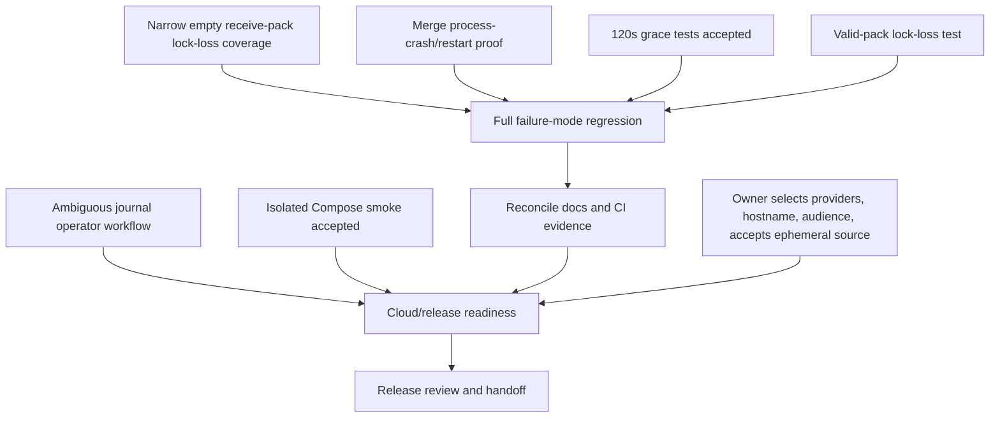

# Code Forge — verified acceptance task board

## Current acceptance snapshot (2026-10-27; older records below are historical)

- Last CI-verified runtime candidate on `thviet` is `70500d849f1d0e31e64618cc51f311161f716459`; `MVP verification` #150 passed all 28/28 steps on that exact runtime SHA. Later test/docs commits are follow-ups and do not change the runtime candidate until their exact runs finish. No Render deployment or final cloud acceptance is implied.
- Hosted `MVP verification` #159 ([run 40362337076](https://github.com/VuLeCoder/Code-forge/actions/runs/40362337076)) completed **success, 28/28** on exact test/docs parent SHA `3153dbb`; #160 ([run 40435241679](https://github.com/VuLeCoder/Code-forge/actions/runs/40435241679)) completed **success, 28/28** on exact `407a5a2`, verifying T49's collaborator user-lock race on hosted CI. T50 is committed as `f6f2a3a`; exact hosted run #161 (`40436044748`) is still in progress, while local focused E2E remains blocked until Docker Desktop is available.
- T33/T34 local acceptance: locked-owner anonymous public Git read passed in the full admin E2E (3/3); the T32 crash test now matches the exact observer-held advisory lock after independent review found its generic waiter query could observe an unrelated lock. PostgreSQL decoy/actual-waiter experiments reproduced the flaw and validated the fix; Linux PR/push-audit/admin regression passed 21/21 and backend unit passed 195/195. CI #139 then passed on the corrected candidate. Broad recovery/operator-resolution and cloud release remain open.
- P3/P4 merge→delete lock-order acceptance: **PASS**. The test pauses merge before ref CAS, observes DELETE queued on the same PostgreSQL advisory lock, then verifies merge commit/ref, COMPLETED journal, MERGED PR and audit before soft-delete. Full PR E2E: 14 runnable passed, 2 intentional crash-case skips; CI #118 passed the complete workflow.
- Cloud P2/P8: **PARTIAL; BTL owner/collaborator PR journey smoke verified, release recovery still open**. On 2026-10-26, deployed readiness returned 200; local frontend→Render API returned expected 200/401/400; public anonymous clone/fetch and private PAT clone/push/fetch passed. Owner PR #1 passed create→compare/files→merge→fetch at `f8468c6063a70aea4306f6ab6de7a1c58cafb7bd` (two parents). A separate WRITE invitation was accepted; collaborator push/PR and owner merge succeeded; collaborator fetch observed `481d75d44f2ad2855bab853cb55d28c96235877b` (two parents). Temporary PATs were revoked and sessions logged out. A local mobile check confirmed the demo-storage warning is visible at 375×812 without horizontal overflow. Admin bootstrap CLI/PostgreSQL E2E passed 5/5 against an isolated loopback test DB; its temporary schema was cleaned. Read-only dashboard preflight now confirms Render service `code-forge-api-thviet` uses `VuLeCoder/Code-forge` branch `thviet`, is Live at `388c584`, has Auto-Deploy `After CI Checks Pass`, and is Free with no persistent disk; Neon project `Code Forge` is separate from `BUS Ticket`, uses production in Singapore on the Free plan with a 6-hour history window. Admin/audit cloud, payload quota, source persistence after restart, migration, backup/restore and source recovery remain unverified. Historical `4407e7d` P1001 cause is unknown. No redeploy/restart or cloud migration was run.
- Remaining P3/P4 matrix and release/handoff evidence: **OPEN**. Restore-vs-purge race passed hosted Actions #122; scheduled temp-janitor E2E passed #123. T12 acceptance additions for refresh-token reuse, same-operation retry while merge is PENDING, and preserving a locked account during admin promotion are covered by local E2E and green CI #125. CI #126 also passed after the current evidence update. Issue #5 push-audit core paths are implemented. T32 verifies the pre-proof crash remains unknown and fenced; T37 (`34ba7b0`) now verifies recovery after durable child-success proof but before journal finish, including one audit and a subsequent push. The audit-failure race, idempotence, admin retention boundary and operation-ID collision remain covered locally. Advisory-lock connection loss, broader recovery, cloud release and issue #6 operator resolution remain open and fail-closed. Vercel is deferred/out of scope.

Use this snapshot for current status; older task records and run references below remain historical.

**Historical source/CI snapshot (2026-10-25):** branch `thviet` and `origin/thviet` were at exact SHA `41c23eca31823b9f12dc93924699d873120b0788`. Local PR-pagination gates passed: backend PR E2E 6/6 (Linux-only crash test skipped on Windows), GitStorage real-Git 21/21, frontend pulls/proxy Playwright 15/15, backend/frontend lint and typecheck, and `git diff --check`. Hosted run [#70 / `40170763221`](https://github.com/VuLeCoder/Code-forge/actions/runs/40170763221) failed at frontend Playwright (53/55): desktop and narrow admin accessibility tests both failed the Escape focus-return assertion at `frontend/test/admin-accessibility.spec.ts:54`; `[WebServer]` also logged `Không thể tải hồ sơ lúc này`. Run #69 (`40170013908`) failed the same flow on predecessor `94ceb6f` at a different dialog-visibility assertion. The admin fix was later verified. Full-stack, Docker, migration, and diff-whitespace stages were skipped in #70. These results did not complete P4 or establish cloud acceptance.

State baseline: branch `thviet`; code is pushed through exact SHA
`24e6abc69cb947d575306134c362491bc96c93ad`. The code-fix commits are
`896575c` (destroy repository lock clients on release errors), `45cb1f4`
(restore admin dialog focus), and `24e6abc` (expose Gemini effort tiers for
AGY). Run `40167861108` succeeded in 5m32s on that exact SHA; hosted CI is
green for this code revision. Markdown consolidation and acceptance-status
updates remain local, uncommitted, and unpushed; they are not in that SHA.
Earlier pushed commit `1209bca` adds the test-only
throttler-storage fixture for the long PR E2E; `f1fb835` added Gemini 3.8 Flash
tiers to the local AGY wrapper. The current wrapper defaults to Gemini 3.8
Flash Medium. Claude Sonnet/Opus 5.5 are explicit family choices; the user
prefers Gemini 3.8 first, Claude only when intentionally selected/available,
then Gemini 4 Argon after a scoped 3.8 timeout and observed Claude quota error.
No quota-balance field is available for pre-checking. User reports 3.8 resets
hourly and Gemini 4 weekly. The latest wrapper/docs update is not in pushed
SHA `24e6abc`. The
Linux-only child-API
crash/restart reconciliation E2E was added in `e5eda1a` and its timeout raised
to 180 seconds in `250ffdc`.
Latest local backend unit tests pass (17 suites / 113 tests); workspace
typecheck/lint/build pass; focused backend lock spec passes 3/3; frontend
Playwright passes 52/52 and full-stack Playwright passes 3/3. Full-stack used
the dedicated existing `codeforge-merge-crash-test` PostgreSQL DB
`code_forge_test` on loopback port 49588, creating and cleaning only the
harness's random schema and temporary Git root; no Docker volume was reset or
deleted. The separate PR-specific E2E was refused by its `_test` safety guard
because `backend/.env` points to a non-test DB. This is not a test failure or
integration result. The Linux-only crash/restart E2E is skipped on Windows.
Later verification supersedes the older 113-test count: backend unit tests are
17 suites / 114 tests, and the full PR E2E suite passed 6/6 on isolated
tmpfs-only PostgreSQL. Its Linux crash/restart case was skipped on Windows.
This supersedes the earlier guarded PR E2E refusal above (a safe block caused
by non-test `.env`, not a product failure). AGY's current default
`gemini-3.8-flash-medium` reviewed only `git-storage.service.spec.ts` with
slash expansion disabled and returned exact output `NO_ACTIONABLE_FINDING`.
A larger two-test slice of `pull-requests.e2e-spec.ts` timed out after 45s on
Gemini 3.8 Medium; one exact bounded Gemini 4 Medium fallback timed out after
60s. Both returned no usable findings, no further retries occurred, and
neither counts as an audit pass. An earlier successful Gemini 4 Medium review
covered the PR lifecycle test and then-current Git compare test, not the later
storage-reset E2E. Broad Gemini 3.8 timeouts remain unsuccessful attempts.
Additional isolated evidence: PostgreSQL HTTP PR-author/owner lifecycle E2E
passed 1/1 in a newly created tmpfs-only test container, verified removed
without volumes; the real-Git storage suite passed 20/20, including unrelated
history (`NO_MERGE_BASE`) with refs unchanged. Full backend typecheck and
`git diff --check` passed. An earlier AGY `gemini-4-argon-medium` Medium
read-only review covered the PR lifecycle test and then-current Git compare
test and found no actionable issue; it did not cover the later storage-reset
E2E, and AGY did not run the tests. This remains distinct from the later PR
slice review timeouts recorded above.
Runs `40164718122` (`e5eda1a`), `40164867636`
(`250ffdc`), `40165071044` (`c98f548`), and `40165266658` (`f1fb835`) all
failed at backend E2E; their causes are recorded in the execution log. Run
`40166209913` then passed the crash/restart test but failed later with HTTP
429, and `40166484359` repeated that later 429. Run
`40166811302` remains FAILED as a historical run on exact old pushed SHA
`1209bca8cde9e3f594c6dc44036426a9e73f7ea6`: backend unit/E2E, lint, typecheck,
and build passed; frontend Playwright had 51 passed / 1 failed because the
desktop Escape case did not restore focus to “Khóa tài khoản”
(`frontend/test/admin-accessibility.spec.ts:7`, assertion line 54). Local
frontend E2E passes 52/52, focused admin accessibility passes 2/2, and
full-stack Playwright passes 3/3. These code fixes are now committed/pushed;
the documentation consolidation remains local/uncommitted.
Later hosted full-stack, Docker, migration, and diff-whitespace steps were
skipped in `40166811302`. Replacement run `40167861108` succeeded in 5m32s on
exact SHA `24e6abc69cb947d575306134c362491bc96c93ad`; all gates in that hosted
workflow passed. This is hosted CI evidence, not cloud-release verification.
The recorded earlier backend-E2E step was
`Run corepack pnpm --filter backend test:e2e` for the latter three and
`Run corepack pnpm --filter backend test:e2e:failure` for `40164718122`.
Historical run #56 remains a verified green ancestor run
([40162474987](https://github.com/VuLeCoder/Code-forge/actions/runs/40162474987))
on ancestor `9c2eb81`; it passed all workflow gates on that exact commit. It has
been superseded by successful run `40167861108` on `24e6abc`. Earlier runs #54
(`40159331450`) and #55 (`40160123068`) failed at backend E2E; their exact
failure cause remains unknown because GitHub gates logs behind sign-in. Parent
`6ad5ad1` passed hosted run `40158875902`; earlier `d9b728f` and `cdb2d1f` also
passed. CI success is not cloud-release acceptance.
This board separates verified implementation from missing acceptance evidence.

## Verified now

- **BTL cloud Git smoke (2026-10-26):** Anonymous clone/fetch succeeded for the public fixture `btl-demo-873496/btl-demo`. Authenticated clone/push/fetch succeeded for private fixture `btl-demo-user-579004/btl-smoke`; pushed branch `cloud-smoke-579004` resolved to the same fetched SHA `05c7aad9dd6e3bd5fcfcc8a7586de83df3c28935`. The temporary PAT was revoked and session logged out. Fixtures contain only demo README/empty test commit; no project source or secrets. This closes the basic direct Render Git protocol smoke, not cloud PR/invitation/admin or restart-recovery acceptance.
- **BTL cloud PR smoke (2026-10-26):** New private fixture `btlclouda930e3db/pr-smoke`; branch `btl-pr-feature`; PR #1 passed create, compare (`READY`), files/diff, owner permission and merge. Fetch confirmed `main` points at merge commit `f8468c6063a70aea4306f6ab6de7a1c58cafb7bd` with exactly two parents. Temporary PAT revoke and logout requests succeeded. This is API/Git integration evidence on Render, not a visual browser run or collaborator/admin acceptance.
- **BTL cloud collaborator smoke (2026-10-26):** Owner `btlown653b1a6a` invited `btlcol653b1a6a` with `WRITE`; collaborator listed and accepted the invitation, authenticated-cloned and pushed `collaborator-feature`, then created PR #1. Owner compare/diff and `canMerge` passed; owner merged. Collaborator fetch resolved `main` to `481d75d44f2ad2855bab853cb55d28c96235877b` with two parents. Temporary PAT revoke and both logouts succeeded. Fixture repository `collab-smoke` contains only a smoke file; admin, stale/conflict and recovery checks are not implied.

- P0 latest fully green workflow `40167861108` passed all gates in 5m32s on
  exact SHA `24e6abc69cb947d575306134c362491bc96c93ad`.
  Historical run `40166811302` remains FAILED on old SHA `1209bca`: backend
  unit/E2E, lint, typecheck, and build passed; frontend Playwright failed 1/52
  at dialog focus restoration after Escape. Local frontend E2E now passes 52/52
  and focused admin accessibility passes 2/2; code fix `45cb1f4` is now pushed.
  Later full-stack, Docker, migration, and diff-whitespace steps were skipped.
  Replacement run `40167861108` succeeded in 5m32s on pushed SHA
  `24e6abc69cb947d575306134c362491bc96c93ad`.
  Local candidate API/migration images passed content smoke (Git 2.39.5,
  executable hook, Prisma client; Prisma 6.19.3/client resolution); no migration
  was applied and no volume was reset/deleted.
  Docker API/migration image checks passed on the earlier green run.
  Compose runtime smoke now passes on a unique project: 7/7 migrations applied,
  backend healthcheck and `GET /api/v1/health/ready` returned 200. Its
  containers/network were stopped; the two test-owned project volumes remain
  and no existing container/volume was touched.
- P1 auth, session, invitation, REST error contract, and OpenAPI work is present
  with unit and PostgreSQL/HTTP coverage. A further security audit found a
  locked-PAT read race; commit `a49656d` now rechecks user status on the final
  Git authorization path for reads and writes. Focused regression is 3/3 and
  backend typecheck passed; hosted run `40158089595` passed.
- P3/P4 primary push, quota, repository locking, PR compare/merge, conflict,
  same-operation replay, write fences, and DB-failure reconciliation are present.
  Current branch-byte enforcement and 255/256 UTF-8 byte boundary tests are in
  source; do not repeat the stale “fix in progress” claim in older ledgers.
- A repository-lock service finding was reproduced RED then fixed locally.
  Codex security reviewer, Nemotron Ultra via Continue CLI, and one successful
  AGY read-only `claude-sonnet-5-5-medium` review found no blocking issue in
  scope. Focused lock spec passes 3/3. The fix is committed/pushed as
  `896575c`; run `40167861108` passed on `24e6abc`. Remaining P3/P4 matrix cases
  are not closed.
  AGY model listing included Gemini 4 Argon, Gemini 3.8 Flash, Claude Opus and
  Sonnet 5.5, and GPT-OSS 120B; Gemini review timed out and is not counted.
- A fresh `PENDING` merge journal observes the 120-second process-exit
  grace as push reconciliation. Unit coverage now checks the cutoff duration
  and confirms `NEEDS_RECONCILIATION` has no cutoff; a fresh needs-reconciliation
  E2E case was added and passes on isolated PostgreSQL. A caught metadata
  transaction failure now transitions PENDING to NEEDS_RECONCILIATION,
  preserving immediate recovery while reserving the grace for possible process
  exit. Backend unit passes 16 suites / 110 tests; backend E2E passes 9 suites /
  33 tests locally (Jest `--forceExit` required after its open-handle warning).
  Backend lint, typecheck, build, and hosted run `40158089595` pass.
- The repository-lock connection-loss test passed on isolated PostgreSQL after
  fixing the one-shot pg client error listener in `b538c65`. It proves only
  cancellation while receive-pack waits for pack input; it does not prove
  ref safety during a valid in-flight push. Commit `b51c88c` makes its Git
  commit fixture independent of global identity. The separate valid-pack test
  is now integrated and the latest hosted workflow is green.
  Commit `e5eda1a` adds a separate Linux-only E2E that kills a child API after
  Git advances the target ref but before PR metadata commits, then starts a
  replacement API and expects startup maintenance to reconcile the journal.
  Commit `250ffdc` raises its Jest timeout from 119 to 180 seconds. Backend
  latest local unit tests pass (17 suites / 113 tests), as do workspace
  typecheck/lint/build and focused lock spec 3/3. Full-stack Playwright passes
  3/3 against the dedicated existing test DB with only the harness schema/temp
  Git root created/cleaned; no Docker volumes were reset/deleted. The separate
  PR-specific E2E was refused by its `_test` guard because `backend/.env` points
  to a non-test DB; this is neither a test failure nor integration evidence.
  The Linux-only test is skipped on Windows.
  Runs `40164718122`,
  `40164867636`, `40165071044`, and `40165266658` all failed at backend E2E
  (the first at `test:e2e:failure`, the others at `test:e2e`); logs identify a
  test-owned advisory-barrier wait-order deadlock, as detailed in the execution
  log. Run `40166209913` showed the crash/restart test passing before a later
  429, and run `40166811302` passed the complete backend E2E command. The full
  workflow still failed at the desktop accessibility focus assertion in
  `frontend/test/admin-accessibility.spec.ts:7` (assertion line 54). The
  earlier Windows/Docker test failure (one PostgreSQL advisory-lock waiter
  persisted after 60 seconds) remains historical evidence and does not prove
  either a product defect or success. Do not force-terminate that session on
  the success path.
- P5 PR/admin UI local browser gates pass after a focus fix: focused admin
  accessibility 2/2, frontend E2E 52/52, and full-stack Playwright 3/3. Hosted
  run `40166811302` remains failed on the old SHA with its single Escape
  focus-restoration failure. The fix is committed/pushed as `45cb1f4`; new run
  `40167861108` succeeded in 5m32s on `24e6abc`; the former hosted failure is
  resolved for that code revision. Screen-reader/manual review remains.
  Manual screen-reader and physical-device review remain outstanding; earlier
  hosted run `40162474987` passed the frontend/browser gates on `9c2eb81`.
- P6 admin bootstrap, lock/unlock, private-source denial, audit filtering,
  restore, and database-backed maintenance batch/retention/idempotence coverage
  are present. Issue #5 remains open because permanently ambiguous journal
  operations have no supported operator resolution tool.
- Static review previously found no confirmed vulnerability in its scope. A
  subsequent focused audit found and fixed the locked-PAT read race in pushed
  commit `a49656d`; final user-lock-vs-active-child semantics remain an
  in-flight authorization boundary. Cloud proxy/TLS behavior was not tested.

## Remaining work breakdown

### Merge recovery system model

```mermaid
sequenceDiagram
  participant C as Client
  participant A as API
  participant D as PostgreSQL journal
  participant G as Bare Git repository
  participant R as Reconciler after restart
  C->>A: merge(snapshot, operationId)
  A->>D: persist PENDING operation + expected refs/generation
  A->>G: build two-parent candidate; compare-and-swap target ref
  G-->>A: target ref updated
  Note over A,D: Process may die before metadata transaction
  A->>D: update PR + audit + operation COMPLETED atomically
  R->>D: load unresolved operation
  R->>G: inspect generation, target ref, candidate ancestry/parents
  alt evidence proves successful merge
    R->>D: idempotently complete PR/audit/journal
  else evidence proves no ref movement
    R->>D: mark safe failure
  else outcome is ambiguous
    R->>D: preserve unresolved state; keep repository writes fenced
  end
```

This model is the acceptance contract for the crash task. A database trigger
failure tests error handling, but it does not prove behavior when the process
actually disappears between the Git ref CAS and PostgreSQL metadata commit.



| ID | Owner | Scope and dependencies | Acceptance invariant |
| --- | --- | --- | --- |
| A | Backend test agent; Codex reviews | Integrated as `b538c65`, fixture follow-up `b51c88c`. Focused PostgreSQL test passed 2/2 and full backend E2E passed 9 suites / 34 tests locally with Git global identity disabled. The test sends no pack bytes and does not prove ref safety during a valid push. | Narrow cancellation coverage only. Do not claim active-push/ref-update safety without the separate valid-pack test. |
| B | Backend test agent; Codex integrates | Integrated/pushed as `e5eda1a` with timeout follow-up `250ffdc`, `backend/test/pull-requests.e2e-spec.ts`. New Linux-only test kills a child API after target ref movement and before PR metadata commit, waits for natural PostgreSQL session exit, pauses the parent test scheduler, then starts a replacement API whose startup maintenance must reconcile. Timeout is 180 seconds. Latest local backend unit tests pass (17 suites / 113 tests), workspace typecheck/lint/build pass, focused lock spec passes 3/3, full-stack Playwright passes 3/3, and the Linux-only test is skipped on Windows. Full-stack used the dedicated existing test database with only the harness schema and temp Git root created/cleaned; no Docker volume was reset/deleted. The separate PR-specific E2E was refused by its `_test` guard because `backend/.env` points to a non-test DB; it is neither a test failure nor local integration acceptance. Historical run `40166811302` passed backend E2E on old SHA `1209bca` but failed frontend Playwright (51/52). The focus fix is committed/pushed as `45cb1f4`; replacement run `40167861108` succeeded in 5m32s on exact SHA `24e6abc69cb947d575306134c362491bc96c93ad`. Markdown updates remain uncommitted/unpushed and were not in the hosted run. The earlier Windows/Docker run retained one advisory-lock waiter for 60s and remains inconclusive historical evidence. Local commit `a9ac678` adds a separate pre-proof push process-crash test with Linux runtime evidence; hosted CI is pending. | Backend merge crash/restart test passed in hosted run `40166811302`; the new pre-proof push crash boundary passed locally in Linux Docker, but is not hosted-CI verified. No success-path `pg_terminate_backend`. |
| C | Codex lead + security reviewer; owner decisions required | Design a protected operator workflow for permanently ambiguous/cross-type journals. Keep current fail-closed behavior and runbook until an approved contract exists. | Explicit operator authorization, evidence-based allowed decisions, optimistic concurrency/idempotency, immutable audit, fail-closed unknown outcomes, no manual SQL/ref repair, and tests. Owner must decide ADMIN vs operator role and one vs two approvers before implementation. |
| D | Codex QA | Run the complete P3/P4 failure matrix after A/B/F evidence is recorded. Run `40166811302` remains FAILED on old SHA `1209bca`: backend gates passed, frontend E2E failed 1/52, later steps were skipped. Local backend unit 17/113, workspace typecheck/lint/build, focused lock test 3/3, frontend E2E 52/52, and full-stack Playwright 3/3 pass; full-stack used only isolated test-owned schema/temp Git root on the dedicated test DB, with no Docker volume deletion/reset. PR-specific E2E was refused by the safety guard due to non-test `backend/.env`; do not describe as failure or integration pass. Code fixes are pushed; docs remain uncommitted/unpushed. New run `40167861108` passed in 5m32s on exact SHA `24e6abc69cb947d575306134c362491bc96c93ad`. Keep old hosted evidence distinct from current local results and earlier 429 runs. Do not infer crash or active-push coverage from mocks or DB-trigger errors. | Current code hosted workflow passes; remaining real Git/PostgreSQL matrix and local integration limitations remain visible; `git diff --check` passes. |
| E | Codex QA + `/root/pending_reconcile_grace_tests` | Both review findings are in ancestor `c944f9a`, present in `b51c88c`. Unit suite passed 15/15; maintenance PostgreSQL E2E file passed 2/2 on isolated data. | Accepted: cutoff is 119–121s; no `createdAt` filter on `NEEDS_RECONCILIATION`; a recent row is processed immediately. |
| F | Backend test agent; Codex integrates | Integrated in `9c2eb81`, `backend/test/repository-lock.e2e-spec.ts`. It creates a feature ref using the zero old OID, generates a real PACK, and blocks in temporary `pre-receive`. Focused disposable Linux runner passed 1/1; Windows local suite passed 2/2 with the POSIX-only case skipped; independent follow-up security review found no remaining actionable issue. Hosted run #56 passed on the integrated commit. | Linux runtime proves lock loss cancels valid receive-pack with HTTP 503, leaves feature ref absent and main unchanged, releases the lock connection, and exits Git plus hook processes. Windows skip is not counted as runtime proof. |
| G | Codex lead | Reconcile implementation/status/next-actions/deployment/security/issue records to pushed `24e6abc` plus current local verification. Preserve owner-authored text; distinguish historical and current CI. | Preserve `40166811302` as FAILED on old SHA `1209bca`; record `40167861108` as succeeded in 5m32s on exact `24e6abc69cb947d575306134c362491bc96c93ad`; current Markdown consolidation/status changes remain local and outside that SHA; Compose state, P3/P4 gaps, and open cloud/operator tasks remain visible; `git diff --check` passes. |
| H | Codex QA | Complete: unique-project Compose runtime, loopback ports, migrations 7/7, backend health/readiness 200. Containers/network were stopped without `-v`; test-owned volumes retained, existing volumes untouched. | Local Compose runtime smoke accepted. |
| I | User + Codex | Confirm authorized Render/Neon resources; decide demo hostname/audience and explicitly accept ephemeral Git source storage. Vercel is deferred/out of scope per the latest owner objective, not a completed integration. Do not share credentials in chat. | Render/Neon identities and canonical origin known; source-loss warning accepted. |
| J | Codex release | On owner-approved cloud resources, test direct Render Git HTTPS including >4.5 MB, auth/private/public, cold start, restart/source-loss, recovery, PR/admin, TLS/proxy and backup/restore. | Checklist records URL, release commit and evidence; source reset/recovery rehearsal actually passes; no local/CI result is presented as cloud evidence. |
| K | User + Codex | Review the smoke checklist and recovery behavior before sharing the demo URL. | Owner explicitly approves sharing after source-loss limitations are visible and understood. |

## Issue tracker

Live GitHub API recheck on 2026-10-25 found issues #3 (PR/Git recovery), #4
(Docker/CI/cloud release), #5 (durable Git push audit), and #6 (audited
ambiguous-journal resolution) open. Keep
updates as drafts unless the owner selects an issue to comment on. Do not create
duplicates; issue #5's remaining operator-resolution gap should first be
described as a scoped draft under that existing issue or a new issue only after
checking whether its owner wants the extra tracking item. Issue #6 now tracks
the audited ambiguous-journal workflow:
[Issue #6](https://github.com/VuLeCoder/Code-forge/issues/6). The local
`docs/operations/issue-draft-ambiguous-git-journals.md` is supporting draft
material, not an unpublished issue.

## Agent execution and handoff record

Every delegated or leader-owned task must leave a durable record in
`docs/operations/task-execution-log-2026-10-25.md`: task ID/owner, status,
worktree/branch, owned paths, exact files changed, commit, verification command
and observed result, findings/errors/blockers, and the next safe action. Do not
write secrets, source excerpts, tokens, cookies, or database URLs into the log.
Timeout/unknown is not success; preserve the worktree and record the exact
handle/path and last observed state. Before a `/handoff`, include the current
branch/commit, uncommitted files, active jobs, pending user-only choices, test
evidence, and unresolved risks so the next agent can resume without guessing.

## User-only prerequisites

1. Select or create the GitHub/Vercel/Render/Neon resources and grant interactive
   access as needed; never paste passwords, OTPs, PATs, cookies, or connection
   strings into chat.
2. Choose the canonical demo hostname and intended audience.
3. Explicitly accept that free Render Git storage is ephemeral and source may
   disappear on sleep, restart, or redeploy while metadata persists.
4. Review the final smoke/recovery checklist before the public URL is shared.
