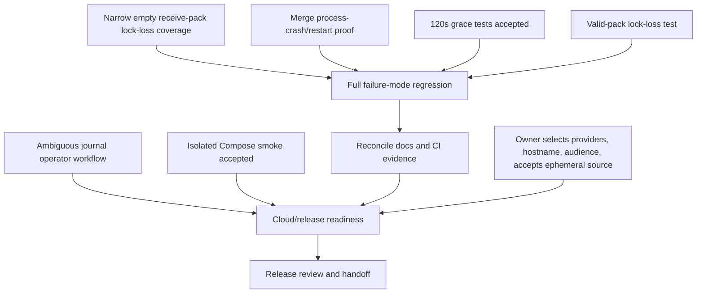

# Code Forge — verified acceptance task board

State baseline: branch `thviet`, pushed commit `250ffdc` increases the timeout
for the Linux-only child-API crash/restart reconciliation E2E added in `e5eda1a`.
Backend unit tests pass locally (17 suites / 111 tests), and typecheck plus
`git diff --check` still pass; targeted lint still reports only the pre-existing
`await-thenable` at line 507. This unit run does not include the new E2E, which
has not run locally. Hosted run `40164718122` for `e5eda1a` completed failure
at `Run corepack pnpm --filter backend test:e2e:failure`; the exact failing test
and cause are unknown pending authenticated logs. Run `40164867636` for
`250ffdc` is currently in progress. The latest verified
green hosted run remains #56
([40162474987](https://github.com/VuLeCoder/Code-forge/actions/runs/40162474987))
on ancestor `9c2eb81`; it passed all workflow gates on that exact commit. Earlier runs #54
(`40159331450`) and #55 (`40160123068`) failed at backend E2E; their exact
failure cause remains unknown because GitHub gates logs behind sign-in. Parent
`6ad5ad1` passed hosted run `40158875902`; earlier `d9b728f` and `cdb2d1f` also
passed. CI success is not cloud-release acceptance.
This board separates verified implementation from missing acceptance evidence.

## Verified now

- P0 latest hosted workflow `40162474987` passed all gates on `9c2eb81`; earlier
  backend E2E failures are retained as historical and unexplained. Docker
  API/migration image checks pass.
  Compose runtime smoke now passes on a unique project: 7/7 migrations applied,
  backend healthcheck and `GET /api/v1/health/ready` returned 200. Its
  containers/network were stopped; the two test-owned project volumes remain
  and no existing container/volume was touched.
- P1 auth, session, invitation, REST error contract, and OpenAPI work is present
  with unit and PostgreSQL/HTTP coverage. A further security audit found a
  locked-PAT read race; commit `a49656d` now rechecks user status on the final
  Git authorization path for reads and writes. Focused regression is 3/3 and
  backend typecheck passed; hosted run `40158089595` passed.
- P3/P4 primary push, quota, repository locking, PR compare/merge, conflict,
  same-operation replay, write fences, and DB-failure reconciliation are present.
  Current branch-byte enforcement and 255/256 UTF-8 byte boundary tests are in
  source; do not repeat the stale “fix in progress” claim in older ledgers.
- A fresh `PENDING` merge journal observes the 120-second process-exit
  grace as push reconciliation. Unit coverage now checks the cutoff duration
  and confirms `NEEDS_RECONCILIATION` has no cutoff; a fresh needs-reconciliation
  E2E case was added and passes on isolated PostgreSQL. A caught metadata
  transaction failure now transitions PENDING to NEEDS_RECONCILIATION,
  preserving immediate recovery while reserving the grace for possible process
  exit. Backend unit passes 16 suites / 110 tests; backend E2E passes 9 suites /
  33 tests locally (Jest `--forceExit` required after its open-handle warning).
  Backend lint, typecheck, build, and hosted run `40158089595` pass.
- The repository-lock connection-loss test passed on isolated PostgreSQL after
  fixing the one-shot pg client error listener in `b538c65`. It proves only
  cancellation while receive-pack waits for pack input; it does not prove
  ref safety during a valid in-flight push. Commit `b51c88c` makes its Git
  commit fixture independent of global identity. The separate valid-pack test
  is now integrated and the latest hosted workflow is green.
  Commit `e5eda1a` adds a separate Linux-only E2E that kills a child API after
  Git advances the target ref but before PR metadata commits, then starts a
  replacement API and expects startup maintenance to reconcile the journal.
  Commit `250ffdc` raises its Jest timeout from 119 to 180 seconds. Backend
  unit tests pass locally (17 suites / 111 tests), as do typecheck and
  diff-check; these do not execute the new E2E. Hosted run `40164718122` failed
  at the aggregate backend E2E step, exact test and cause unknown; run
  `40164867636` for `250ffdc` is in progress. The Linux runtime result is pending. The
  earlier Windows/Docker test failure (one PostgreSQL advisory-lock waiter
  persisted after 60 seconds) remains historical evidence and does not prove
  either a product defect or success. Do not force-terminate that session on
  the success path.
- P5 PR/admin UI has browser coverage. The new admin keyboard/dialog-focus test
  passes at desktop and 375px widths (2/2); frontend lint passes. Manual
  screen-reader and physical-device review remain outstanding; latest exact
  hosted run `40162474987` passes the frontend/browser gates.
- P6 admin bootstrap, lock/unlock, private-source denial, audit filtering,
  restore, and database-backed maintenance batch/retention/idempotence coverage
  are present. Issue #5 remains open because permanently ambiguous journal
  operations have no supported operator resolution tool.
- Static review previously found no confirmed vulnerability in its scope. A
  subsequent focused audit found and fixed the locked-PAT read race in pushed
  commit `a49656d`; final user-lock-vs-active-child semantics remain an
  in-flight authorization boundary. Cloud proxy/TLS behavior was not tested.

## Remaining work breakdown

### Merge recovery system model

```mermaid
sequenceDiagram
  participant C as Client
  participant A as API
  participant D as PostgreSQL journal
  participant G as Bare Git repository
  participant R as Reconciler after restart
  C->>A: merge(snapshot, operationId)
  A->>D: persist PENDING operation + expected refs/generation
  A->>G: build two-parent candidate; compare-and-swap target ref
  G-->>A: target ref updated
  Note over A,D: Process may die before metadata transaction
  A->>D: update PR + audit + operation COMPLETED atomically
  R->>D: load unresolved operation
  R->>G: inspect generation, target ref, candidate ancestry/parents
  alt evidence proves successful merge
    R->>D: idempotently complete PR/audit/journal
  else evidence proves no ref movement
    R->>D: mark safe failure
  else outcome is ambiguous
    R->>D: preserve unresolved state; keep repository writes fenced
  end
```

This model is the acceptance contract for the crash task. A database trigger
failure tests error handling, but it does not prove behavior when the process
actually disappears between the Git ref CAS and PostgreSQL metadata commit.



| ID | Owner | Scope and dependencies | Acceptance invariant |
| --- | --- | --- | --- |
| A | Backend test agent; Codex reviews | Integrated as `b538c65`, fixture follow-up `b51c88c`. Focused PostgreSQL test passed 2/2 and full backend E2E passed 9 suites / 34 tests locally with Git global identity disabled. The test sends no pack bytes and does not prove ref safety during a valid push. | Narrow cancellation coverage only. Do not claim active-push/ref-update safety without the separate valid-pack test. |
| B | Backend test agent; Codex integrates | Integrated/pushed as `e5eda1a` with timeout follow-up `250ffdc`, `backend/test/pull-requests.e2e-spec.ts`. New Linux-only test kills a child API after target ref movement and before PR metadata commit, waits for natural PostgreSQL session exit, pauses the parent test scheduler, then starts a replacement API whose startup maintenance must reconcile. Timeout is 180 seconds. Backend unit tests pass locally (17 suites / 111 tests), as do typecheck and diff-check; targeted lint reports only the pre-existing line-507 error. The unit suite does not execute the new E2E. Hosted run `40164718122` failed at `Run corepack pnpm --filter backend test:e2e:failure`; exact failing test/cause is unknown pending authenticated logs. Run `40164867636` for `250ffdc` is in progress. Do not mark accepted. The earlier Windows/Docker run retained one advisory-lock waiter for 60s and remains inconclusive historical evidence. | Hosted Linux E2E must prove natural process/session exit, replacement-startup reconciliation of PR/journal/audit exactly once, idempotent retry, and fetch of the two-parent commit. No success-path `pg_terminate_backend`. |
| C | Codex lead + security reviewer; owner decisions required | Design a protected operator workflow for permanently ambiguous/cross-type journals. Keep current fail-closed behavior and runbook until an approved contract exists. | Explicit operator authorization, evidence-based allowed decisions, optimistic concurrency/idempotency, immutable audit, fail-closed unknown outcomes, no manual SQL/ref repair, and tests. Owner must decide ADMIN vs operator role and one vs two approvers before implementation. |
| D | Codex QA | Run the complete P3/P4 failure matrix after A/B/F evidence is recorded; latest verified hosted CI is green on ancestor `9c2eb81`. Run `40164718122` failed at aggregate backend E2E and exact test/cause remains unknown; run `40164867636` is in progress. Keep older failures separate from current acceptance. Do not infer crash or active-push coverage from mocks or DB-trigger errors. | Each required real Git/PostgreSQL invariant has named test/output on one commit; current hosted/local evidence is recorded; historical failures are labeled unknown; `git diff --check` passes. |
| E | Codex QA + `/root/pending_reconcile_grace_tests` | Both review findings are in ancestor `c944f9a`, present in `b51c88c`. Unit suite passed 15/15; maintenance PostgreSQL E2E file passed 2/2 on isolated data. | Accepted: cutoff is 119–121s; no `createdAt` filter on `NEEDS_RECONCILIATION`; a recent row is processed immediately. |
| F | Backend test agent; Codex integrates | Integrated in `9c2eb81`, `backend/test/repository-lock.e2e-spec.ts`. It creates a feature ref using the zero old OID, generates a real PACK, and blocks in temporary `pre-receive`. Focused disposable Linux runner passed 1/1; Windows local suite passed 2/2 with the POSIX-only case skipped; independent follow-up security review found no remaining actionable issue. Hosted run #56 passed on the integrated commit. | Linux runtime proves lock loss cancels valid receive-pack with HTTP 503, leaves feature ref absent and main unchanged, releases the lock connection, and exits Git plus hook processes. Windows skip is not counted as runtime proof. |
| G | Codex lead | Reconcile implementation/status/next-actions/deployment/security/issue-draft records to current `250ffdc` and the latest verified hosted/local evidence. Preserve owner-authored text; distinguish historic from current results. | Current CI and local evidence are accurate; process-crash E2E stays pending until the hosted Linux result is checked; Compose state and open cloud/operator tasks remain explicit; `git diff --check` passes. |
| H | Codex QA | Complete: unique-project Compose runtime, loopback ports, migrations 7/7, backend health/readiness 200. Containers/network were stopped without `-v`; test-owned volumes retained, existing volumes untouched. | Local Compose runtime smoke accepted. |
| I | User + Codex | Select/authorize GitHub, Vercel, Render, Neon resources; decide demo hostname/audience and explicitly accept ephemeral Git source storage. GitHub interactive sign-in is optional if the owner wants diagnosis of historical failed runs. Do not share credentials in chat. | Resource identities and canonical origins known; source-loss warning accepted. |
| J | Codex release | On owner-approved cloud resources, test direct Render Git HTTPS including >4.5 MB, auth/private/public, cold start, restart/source-loss, recovery, PR/admin, TLS/proxy and backup/restore. | Checklist records URL, release commit and evidence; source reset/recovery rehearsal actually passes; no local/CI result is presented as cloud evidence. |
| K | User + Codex | Review the smoke checklist and recovery behavior before sharing the demo URL. | Owner explicitly approves sharing after source-loss limitations are visible and understood. |

## Issue tracker

Live GitHub API recheck on 2026-10-25 found issues #3 (PR/Git recovery), #4
(Docker/CI/cloud release), and #5 (durable Git push audit) still open. Keep
updates as drafts unless the owner selects an issue to comment on. Do not create
duplicates; issue #5's remaining operator-resolution gap should first be
described as a scoped draft under that existing issue or a new issue only after
checking whether its owner wants the extra tracking item. A separate draft for
the broader push-and-merge recovery workflow is at
`docs/operations/issue-draft-ambiguous-git-journals.md`; it is not posted.

## Agent execution and handoff record

Every delegated or leader-owned task must leave a durable record in
`docs/operations/task-execution-log-2026-10-25.md`: task ID/owner, status,
worktree/branch, owned paths, exact files changed, commit, verification command
and observed result, findings/errors/blockers, and the next safe action. Do not
write secrets, source excerpts, tokens, cookies, or database URLs into the log.
Timeout/unknown is not success; preserve the worktree and record the exact
handle/path and last observed state. Before a `/handoff`, include the current
branch/commit, uncommitted files, active jobs, pending user-only choices, test
evidence, and unresolved risks so the next agent can resume without guessing.

## User-only prerequisites

1. Select or create the GitHub/Vercel/Render/Neon resources and grant interactive
   access as needed; never paste passwords, OTPs, PATs, cookies, or connection
   strings into chat.
2. Choose the canonical demo hostname and intended audience.
3. Explicitly accept that free Render Git storage is ephemeral and source may
   disappear on sleep, restart, or redeploy while metadata persists.
4. Review the final smoke/recovery checklist before the public URL is shared.
