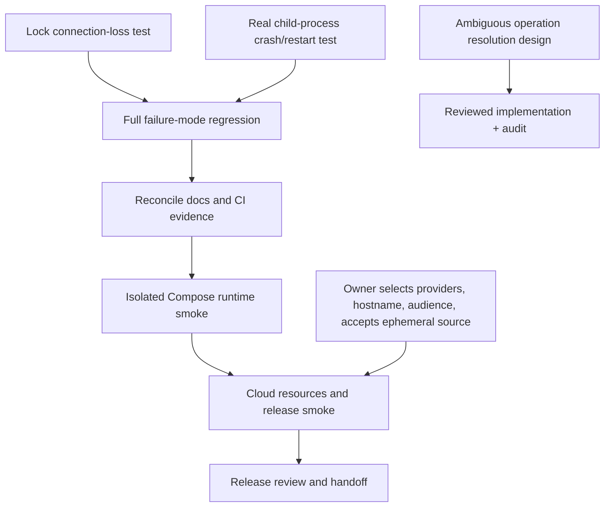

# Code Forge — verified acceptance task board

State baseline: branch `thviet`, pushed commit `cdb2d1f` adds admin keyboard-
accessibility coverage. Hosted run `40158529985` completed successfully for
this exact commit. Parent commit `d9b728f` also passed hosted run `40158089595`
after fixing the metadata-failure reconciliation regression. CI success is not
cloud-release acceptance.
This board separates verified implementation from missing acceptance evidence.

## Verified now

- P0 hosted regression and Docker API/migration image checks pass. Local Compose
  configuration is valid, but the Compose stack has not been started.
- P1 auth, session, invitation, REST error contract, and OpenAPI work is present
  with unit and PostgreSQL/HTTP coverage. A further security audit found a
  locked-PAT read race; commit `a49656d` now rechecks user status on the final
  Git authorization path for reads and writes. Focused regression is 3/3 and
  backend typecheck passed; hosted run `40158089595` passed.
- P3/P4 primary push, quota, repository locking, PR compare/merge, conflict,
  same-operation replay, write fences, and DB-failure reconciliation are present.
  Current branch-byte enforcement and 255/256 UTF-8 byte boundary tests are in
  source; do not repeat the stale “fix in progress” claim in older ledgers.
- A fresh `PENDING` merge journal observes the 120-second process-exit
  grace as push reconciliation. Unit coverage now checks the cutoff duration
  and confirms `NEEDS_RECONCILIATION` has no cutoff; a fresh needs-reconciliation
  E2E case was added and passes on isolated PostgreSQL. A caught metadata
  transaction failure now transitions PENDING to NEEDS_RECONCILIATION,
  preserving immediate recovery while reserving the grace for possible process
  exit. Backend unit passes 16 suites / 110 tests; backend E2E passes 9 suites /
  33 tests locally (Jest `--forceExit` required after its open-handle warning).
  Backend lint, typecheck, build, and hosted run `40158089595` pass.
- Test-only worktrees now contain advisory-lock connection-loss and
  child-process merge-crash E2E cases. Neither is accepted until run green
  against isolated PostgreSQL. The crash fixture's final cleanup ordering is
  corrected, but the post-fix focused run is pending.
- P5 PR/admin UI has browser coverage. The new admin keyboard/dialog-focus test
  passes at desktop and 375px widths (2/2); frontend lint passes. Manual
  screen-reader and physical-device review remain outstanding; exact-head CI
  `40158529985` passed.
- P6 admin bootstrap, lock/unlock, private-source denial, audit filtering,
  restore, and database-backed maintenance batch/retention/idempotence coverage
  are present. Issue #5 remains open because permanently ambiguous journal
  operations have no supported operator resolution tool.
- Static review previously found no confirmed vulnerability in its scope. A
  subsequent focused audit found and fixed the locked-PAT read race in pushed
  commit `a49656d`; final user-lock-vs-active-child semantics remain an
  in-flight authorization boundary. Cloud proxy/TLS behavior was not tested.

## Remaining work breakdown

### Merge recovery system model

```mermaid
sequenceDiagram
  participant C as Client
  participant A as API
  participant D as PostgreSQL journal
  participant G as Bare Git repository
  participant R as Reconciler after restart
  C->>A: merge(snapshot, operationId)
  A->>D: persist PENDING operation + expected refs/generation
  A->>G: build two-parent candidate; compare-and-swap target ref
  G-->>A: target ref updated
  Note over A,D: Process may die before metadata transaction
  A->>D: update PR + audit + operation COMPLETED atomically
  R->>D: load unresolved operation
  R->>G: inspect generation, target ref, candidate ancestry/parents
  alt evidence proves successful merge
    R->>D: idempotently complete PR/audit/journal
  else evidence proves no ref movement
    R->>D: mark safe failure
  else outcome is ambiguous
    R->>D: preserve unresolved state; keep repository writes fenced
  end
```

This model is the acceptance contract for the crash task. A database trigger
failure tests error handling, but it does not prove behavior when the process
actually disappears between the Git ref CAS and PostgreSQL metadata commit.



| ID | Owner | Scope and dependencies | Acceptance invariant |
| --- | --- | --- | --- |
| A | Backend test agent; Codex reviews | Implemented in `E:\Prj1-worktrees\lock-loss-acceptance` on `codex/lock-loss-acceptance`; only `backend/test/repository-lock.e2e-spec.ts` changed. Static setup/typecheck/lint passed, but test execution is blocked by missing `DATABASE_URL_UNPOOLED` and unreachable local test port. Test currently sends no pack bytes and only covers receive-pack waiting for input; it does not prove ref safety mid-push. Not accepted until the scoped behavior passes on isolated DB; broaden P3 proof with a real controlled pack before claiming in-flight ref protection. | Narrow claim: while a Git receive-pack child waits for pack input, terminating the lock-owning DB connection cancels the child and releases its resources; broader active-push/ref-update invariant remains unproven. |
| B | Backend test agent; Codex integrates | Implemented in `E:\Prj1-worktrees\merge-restart-acceptance`, branch `codex/merge-restart-acceptance`. Final cleanup now terminates/waits for child sessions before barrier release. Post-fix E2E is not verified because `DATABASE_URL` was missing; preserve the worktree and do not accept until green. | Evidence proves the child process actually exited before metadata commit; target ref and durable journal remain consistent; restart reconciliation completes metadata/audit once; retry does not make a second merge; fetch sees the same two-parent commit. A DB-trigger exception alone does not satisfy this task. |
| C | Codex lead + security reviewer | Design a protected resolution command for permanently ambiguous/cross-type operations before implementation. Keep the current fail-closed runbook until a reviewed contract exists. | Explicit operator authorization, evidence-based allowed decisions, optimistic concurrency/idempotency, immutable audit, fail-closed unknown outcomes, no manual SQL/ref repair, and tests for unauthorized/stale/ambiguous cases are specified and security-reviewed. |
| D | Codex QA | Inventory remaining P3/P4 failure cases and run the full acceptance suite after A/B. Do not claim crash or lock-loss coverage from mocks or DB trigger failures. | Every required real Git/PostgreSQL invariant has named test/output on one commit; no unexplained hosted/local gate discrepancy; `git diff --check` passes. |
| E | Codex lead | Reconcile `implementation-status.md`, `next-actions.md`, `remaining-work-breakdown.md`, deployment/security records, and issue drafts to local commit `a49656d` and the latest hosted run after push. Preserve existing owner-authored text and distinguish fact from estimate. | No stale “6c921e5/current run in progress”, branch-byte fix-in-progress, or missing maintenance E2E claim; open cloud/manual/operator tasks remain explicitly pending. |
| F | Codex QA | Inspect Compose mounts and project naming first; run stack only with a unique isolated Compose project and test-owned resources. Never reset, remove, or reuse an existing volume/database. | API and database health checks pass; ports are loopback-only; teardown affects only explicitly identified test-owned containers/volumes. Stop before startup if isolation cannot be proven. |
| G | User + Codex | User selects/creates GitHub, Vercel, Render, Neon resources, demo hostname and access audience, then provides interactive account access without sharing secrets in chat. | Resource identities and canonical origins are known; secrets remain in provider settings; source-loss warning is accepted. |
| H | Codex release | On approved cloud resources, run direct Render Git HTTPS (including payload >4.5 MB), auth/private/public, cold start, restart/source-loss, recovery, PR/admin, TLS/proxy and backup/restore smoke. | Checklist evidence records URL, release commit and results; source reset/recovery is actually rehearsed; no CI/local result is presented as cloud evidence. |
| I | User + Codex | Review the smoke checklist and recovery behavior before publishing the demo URL. | Owner explicitly approves release sharing after the source-loss limitations are visible and understood. |

## Issue tracker

Live GitHub API recheck on 2026-10-25 found issues #3 (PR/Git recovery), #4
(Docker/CI/cloud release), and #5 (durable Git push audit) still open. Keep
updates as drafts unless the owner selects an issue to comment on. Do not create
duplicates; issue #5's remaining operator-resolution gap should first be
described as a scoped draft under that existing issue or a new issue only after
checking whether its owner wants the extra tracking item.

## Agent execution and handoff record

Every delegated or leader-owned task must leave a durable record in
`docs/operations/task-execution-log-2026-10-25.md`: task ID/owner, status,
worktree/branch, owned paths, exact files changed, commit, verification command
and observed result, findings/errors/blockers, and the next safe action. Do not
write secrets, source excerpts, tokens, cookies, or database URLs into the log.
Timeout/unknown is not success; preserve the worktree and record the exact
handle/path and last observed state. Before a `/handoff`, include the current
branch/commit, uncommitted files, active jobs, pending user-only choices, test
evidence, and unresolved risks so the next agent can resume without guessing.

## User-only prerequisites

1. Select or create the GitHub/Vercel/Render/Neon resources and grant interactive
   access as needed; never paste passwords, OTPs, PATs, cookies, or connection
   strings into chat.
2. Choose the canonical demo hostname and intended audience.
3. Explicitly accept that free Render Git storage is ephemeral and source may
   disappear on sleep, restart, or redeploy while metadata persists.
4. Review the final smoke/recovery checklist before the public URL is shared.
