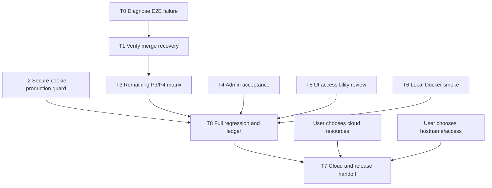

# Code Forge — remaining work breakdown

## Current verified snapshot (2026-10-27)

- Code candidate `f58ef3d` passed hosted MVP verification #193 (`40453128999`) in 6m31s. Documentation checkpoints #194 (`40453906441`) and #195 (`40454832579`) passed; `b557d5a` is the current exact `thviet`/`origin/thviet` SHA.
- The GitHub-style repository Quick setup flow and the full-stack password-fixture correction are included in that verified code candidate. Local maintenance unit coverage is 18/18 on the current worktree.
- Render/Neon evidence remains partial: readiness and direct Git/PR smoke are proven, while migration, backup/restore, quota boundaries, admin/audit cloud, restart/source-loss recovery and release drain remain open. Issue #6 remains fail-closed; Vercel is out of scope.

## Historical execution state (2026-10-26; superseded)

For current acceptance evidence, use [the acceptance board](operations/acceptance-task-board-2026-10-25.md) and [next actions](next-actions.md). The snapshot below predates Render Git/PR smoke and is retained as history.

- `thviet` = `origin/thviet` = `23cb1c7`; code commit `b6411ad` passed hosted Actions [#118 / `40262580445`](https://github.com/VuLeCoder/Code-forge/actions/runs/40262580445). Docs-only workflow #119 on `23cb1c7` was in progress at this snapshot.
- Deterministic merge→delete ordering is now verified locally and in #118: merge is paused before ref CAS, DELETE is observed waiting on the repository advisory lock, and the merge commit/metadata/audit complete before soft-delete. This closes that acceptance case only.
- Render still serves `388c584`; readiness returned HTTP 200 with database/Git/storage up. No cloud migration, backup/restore, direct Render Git, auth/business smoke, or release-recovery rehearsal is accepted. Historical P1001 root cause remains unknown.
- P0–P8 remain incomplete. P2/P8 and other P3/P4 acceptance cases remain open; issue #6 stays fail-closed pending owner policy; Vercel is deferred/out of scope.

The historical snapshots and work-package notes below are retained for audit. Where they conflict with this current execution state, use this section and `docs/implementation-status.md`.

**Historical source/CI snapshot (2026-10-25):** branch `thviet` and `origin/thviet` were at exact SHA `41c23eca31823b9f12dc93924699d873120b0788`. Local PR-pagination gates passed: backend PR E2E 6/6 (Linux-only crash test skipped on Windows), GitStorage real-Git 21/21, frontend pulls/proxy Playwright 15/15, backend/frontend lint and typecheck, and `git diff --check`. Hosted run [#70 / `40170763221`](https://github.com/VuLeCoder/Code-forge/actions/runs/40170763221) failed at frontend Playwright (53/55): both desktop and narrow admin accessibility tests failed Escape focus restoration at `frontend/test/admin-accessibility.spec.ts:54`; `[WebServer]` also logged a profile-load error. Run #69 (`40170013908`) on predecessor `94ceb6f` failed the same flow at a different dialog-visibility assertion. The admin fix was subsequently verified. Full-stack, Docker, migration, and diff-whitespace stages were skipped in #70. P4/cloud acceptance remained incomplete at that time.

State date: 2026-10-25. Branch: `thviet`. Code is pushed through `24e6abc69cb947d575306134c362491bc96c93ad` in commits `896575c`, `45cb1f4`, and `24e6abc`. Hosted run `40167861108` succeeded in 5m32s on that exact SHA. Historical run `40166811302` remains FAILED on old SHA `1209bca8cde9e3f594c6dc44036426a9e73f7ea6` at frontend Playwright (51 passed / 1 failed, admin-dialog focus restoration). Backend unit/E2E, lint, typecheck, and build passed on that old SHA; full-stack, Docker/migration, and diff-whitespace steps were skipped. New local gates pass: backend unit 17 suites/113 tests; workspace typecheck/lint/build; focused backend lock spec 3/3; frontend Playwright 52/52; full-stack Playwright 3/3. Full-stack used the dedicated existing `codeforge-merge-crash-test` database `code_forge_test` on loopback port 49588, creating/cleaning only the harness random schema and temp Git root; no Docker volumes were reset or deleted. Candidate images built and passed local content smoke without applying migration. The separate PR-specific E2E was refused by its `_test` safety guard because `backend/.env` points to a non-test database; it is not a test failure or integration result. Markdown consolidation/status changes remain local, uncommitted, and unpushed, and were not part of hosted SHA `24e6abc`. Codex, Nemotron Ultra, and one AGY read-only `claude-sonnet-5-5-medium` review found no blocking issue in scope; Gemini 3.8 Flash timed out and is not counted. The AGY model list included Gemini 4 Argon, Gemini 3.8 Flash, Claude Opus/Sonnet 5.5, and GPT-OSS 120B. Hosted CI is green for this code revision; remaining P3/P4 work and cloud-release acceptance are open. This register decomposes the approved P0–P8 plan; it does not narrow or replace that scope. For concise acceptance state and execution evidence, see `docs/operations/acceptance-task-board-2026-10-25.md`, `docs/operations/task-execution-log-2026-10-25.md`, and `docs/next-actions.md`.

## Historical detailed verification notes (snapshot carried forward from 2026-10-25)

- Latest local update supersedes older snapshot counts below: backend unit 17 suites / 114 tests passed; full PR E2E passed 6/6 on isolated tmpfs-only PostgreSQL, with Linux crash/restart skipped on Windows. Current AGY `gemini-3.8-flash-medium` reviewed only `git-storage.service.spec.ts` with slash expansion disabled and returned `NO_ACTIONABLE_FINDING`. A larger two-test slice of `pull-requests.e2e-spec.ts` timed out at 45s on Gemini 3.8 Medium; one bounded Gemini 4 Medium fallback timed out at 60s. Both returned no usable findings and neither is an audit pass. Earlier successful Gemini 4 Medium review covered PR lifecycle plus then-current Git compare, not the later storage-reset E2E. Prior broad Gemini 3.8 timeouts are also unsuccessful attempts. Model preference: Gemini 3.8 first; Claude only when intentionally selected/available; Gemini 4 fallback after scoped 3.8 timeout and observed Claude quota error. No quota-balance pre-check is available.
- Historical hosted workflow `40144424454` on `2955e36` passed; it included all 7 backend E2E suites / 28 tests and the full frontend/Docker/migration gates. Latest hosted code run is `40167861108` on `24e6abc`; this does not verify cloud deployment, and the current Markdown edits are not in that run.
- A docs-only commit `a5739cd` passed hosted workflow `40145063512`. Code commit `2305390` adds real-Git merge-conflict and AdminController restore E2E; hosted workflow `40145289400` passed all steps. Local backend lint/typecheck/unit (14 suites / 86 tests) pass; the E2E safety guard rejects the configured non-`*_test` DB before setup.
- Earlier authenticated logs for `40142759395`/`40143199809` identified double-read response and an incorrect assumption about internal journal fields in the detail API. `0403bda` fixed the test contract; `40143448486` passed.
- On `edb0ced`, local backend unit (15 suites/93 tests), full backend PostgreSQL/Git E2E (8 suites/29 tests), Prisma validate/generate, workspace lint/typecheck/build and diff check pass. E2E used a new volume-free PostgreSQL 17 container on a random loopback port; it was stopped and removed. Commit `298fb62` passes backend unit (15 suites/100 tests), targeted PostgreSQL/Git E2E (2 suites/5 tests), workspace lint/typecheck/build and `git diff --check` using another disposable loopback PostgreSQL 17 container. Jest itself returned exit 0; the surrounding PowerShell wrapper reported exit 1 after cleanup, so the wrapper-exit discrepancy is recorded rather than presented as a clean shell gate.
- Hosted merge recovery, same-operation concurrency, admin lock→session/PAT rejection, private-repository boundaries, audit-detail filtering, real-Git merge conflict invariants, and admin restore route success/audit pass in CI. Process-crash/quota/lifecycle cases remain open.
- Latest green hosted workflow is `40167861108`: it succeeded in 5m32s on exact SHA `24e6abc69cb947d575306134c362491bc96c93ad`. Historical run `40166811302` remains failed on old SHA `1209bca`. Local backend unit 17/113, workspace typecheck/lint/build, lock spec 3/3, frontend Playwright 52/52, and full-stack Playwright 3/3 also pass. Full-stack used the dedicated existing test DB with only a random schema and temp Git root created/cleaned, no Docker volume reset/deletion. Candidate API/migration images were locally inspected without applying migrations. The separate PR E2E was refused by the safety guard because `backend/.env` points to a non-test DB; no result is claimed. Markdown consolidation/status changes remain local and were not in the hosted SHA. Earlier backend E2E failures are explained in the execution log. Current pushed source enforces the 255-byte UTF-8 branch suffix limit and tests both 255-byte acceptance and 256-byte rejection; that finding is resolved in `1209bca`.
- A conservative operator triage runbook is drafted at `docs/operations/git-operation-recovery.md`. It deliberately does not prescribe raw SQL/ref repair; permanently ambiguous cross-type rows still need a supported reviewed resolution tool.
- Maintenance cleanup now includes `backend/test/maintenance-cleanup.e2e-spec.ts` with real PostgreSQL batch, retention-boundary, storage-removal, and repeated-run/idempotence assertions; abandoned Git temporary-directory cleanup is implemented. Abrupt-kill cleanup of an in-progress maintenance operation remains distinct from ordinary repeated-run coverage.
- Security audit found no confirmed exploitable vulnerability in reviewed PR/admin/lock paths, but found ordinary Git pushes have no durable attributable audit of actual ref changes. New issue [#5](https://github.com/VuLeCoder/Code-forge/issues/5) tracks a crash-safe journal, reconciliation, privacy, and acceptance matrix.
- Docker Engine responds. Do not reset existing containers/volumes. API and migration images were built on `edb0ced`; the migration image applied all 7 migrations to a fresh disposable DB, and API readiness returned 200. Later, an isolated unique Compose project applied all 7 migrations and returned readiness 200. Its containers/network were stopped without `-v`; only its test-owned volumes remain. A separate isolated test PostgreSQL container is still running for acceptance work; existing container `peaceful_chaplygin` was untouched.
- Latest issue tracking includes open issues #3 (PR/Git race/recovery), #4 (Docker/CI/cloud release), #5 (durable Git push audit), and #6 (audited ambiguous-journal resolution). Issue #6 is published at https://github.com/VuLeCoder/Code-forge/issues/6; the local file is a supporting copy, not an unpublished issue. No issue comments/updates were posted.

## Work packages

### T0 — Diagnose and repair the failing E2E workflow

- **Owner:** Codex lead + backend test agent; user may need to provide authenticated Actions logs.
- **Dependency:** Hosted CI is green on `24e6abc`; remaining P3/P4 matrix work is separate. Historical diagnosis must not be inferred from run duration.
- **Writable scope:** `backend/test/*.e2e-spec.ts` and the smallest directly implicated backend source/test files.
- **Forbidden:** Existing dev/cloud database, secrets, broad refactors, unrelated UI or migration files.
- **Actions:** Root test-contract and merge crash/throttle fixture fixes are pushed through `1209bca`; lock-client cleanup, admin focus restoration, and AGY effort tiers are pushed in `896575c`, `45cb1f4`, and `24e6abc`. Run `40167861108` succeeded in 5m32s on exact pushed SHA `24e6abc69cb947d575306134c362491bc96c93ad`. Run `40166811302` remains failed on the prior SHA with later full-stack/Docker/migration/diff steps skipped. Local backend unit 17/113, workspace typecheck/lint/build, lock spec 3/3, frontend Playwright 52/52, full-stack Playwright 3/3, and candidate image content smoke pass. The PR-specific E2E was refused by the `_test` guard because `backend/.env` points to a non-test DB; this is not a test failure or integration result. Markdown consolidation/status docs remain uncommitted/unpushed and were not part of the tested SHA.
- **Focused reproducer (once isolated PostgreSQL is available):** `corepack pnpm --filter backend exec jest --config test/jest-e2e.json --runInBand test/pull-requests.e2e-spec.ts -t "reconciles a Git-updated merge"` with loopback `*_test` database URLs and isolated `GIT_STORAGE_PATH`; then run the full E2E suite.
- **Acceptance:** Hosted CI acceptance passed in run `40167861108` in 5m32s on exact SHA `24e6abc69cb947d575306134c362491bc96c93ad`. Preserve `40166811302` as FAILED historical evidence on old SHA `1209bca`. Cloud and remaining P3/P4 acceptance stay open.

### T1 — Accept merge ref-update / metadata-recovery path

- **Owner:** Codex lead + backend test agent.
- **Dependency:** T0 E2E access/failure resolved.
- **Files:** `backend/src/maintenance/maintenance-jobs.service.ts`, `backend/src/maintenance/maintenance-jobs.service.spec.ts`, `backend/test/pull-requests.e2e-spec.ts`.
- **Current changes:** Durable actor attribution, awaitable `runOnce`, unit coverage and an isolated PostgreSQL trigger that fails metadata after Git ref CAS.
- **Acceptance:** HTTP merge returns 202 after simulated DB failure; Git ref is a two-parent merge commit while PR metadata stays OPEN; reconciliation marks PR/operation complete with owner attribution and exactly one reconciliation audit; fetch sees the commit; retry with the same operation ID does not move the ref or add audit rows.

### T2 — Enforce production Secure cookies

- **Owner:** Codex lead; security reviewer verifies.
- **Dependency:** Independent of T0.
- **Files:** `backend/src/config/environment.ts`, `backend/src/config/environment.spec.ts`, security ledger.
- **Current changes:** Reject production configuration unless `COOKIE_SECURE=true`; local/test defaults remain false.
- **Acceptance:** Environment suite passes with production missing/false rejected and true accepted; local/test defaults remain valid; full CI passes.

### T3 — Close uncovered P3/P4 negative and recovery matrix

- **Owner:** Codex lead + backend test agent.
- **Dependency:** T0/T1 pass; first compare existing integration tests to avoid duplicate cases.
- **Writable scope:** Targeted backend repository/PR integration tests and smallest necessary backend implementation files.
- **Cases still to inventory:** conflict/no ref movement; stale source/target/version; source missing or storage generation reset; permission/state change before mutation; merge quota and branch-count limits; process crash around CAS/DB boundary; lock-loss/timeout cancellation; push/merge/delete/reset interactions not already covered.
- **Audit result:** Existing real PostgreSQL/Git E2E covers distinct-operation concurrent merges, push–merge, merge–soft-delete, DB metadata failure/reconciliation, same-operation replay, conflict/no-ref-movement, merge quota rejection without ref movement, storage-generation reset, and retry. Commit `298fb62` adds cross-type unresolved-merge fencing; `9c2eb81` includes the branch-byte-limit fix and integrated valid-pack lock-loss test. The valid-pack case passes on a disposable Linux runner 1/1, and hosted run `40162474987` is green on that commit; Windows local E2E correctly skips this POSIX-only process test. The replacement-API crash/restart backend E2E passed as a backend CI gate on `1209bca`, but the overall workflow failed later at frontend Playwright. Current local unit/typecheck/lint/build, lock spec 3/3, frontend 52/52, and full-stack 3/3 pass; full-stack used only an isolated schema/temp Git root on the dedicated test DB. Lock-client cleanup was committed/pushed as `896575c`; hosted run `40167861108` passed in 5m32s on `24e6abc`. The separate PR E2E was refused by its guard due to non-test `backend/.env`, not a product failure. P3/P4 remain open for the other stale/version/storage reset/permissions/push-merge-delete-reset interactions. Markdown status/consolidation edits remain local; cloud reset/recovery remains open.
- **Acceptance:** For each implemented case, isolated PostgreSQL/Git assertions prove whether Git refs and metadata moved, audit outcome, operation state, and retry behavior. No case is counted from mock-only tests when the plan requires real Git/database behavior.

### T4 — Finish P6 admin and maintenance acceptance

- **Owner:** Codex backend + admin UI agent; security reviewer audits.
- **Dependency:** Existing contracts remain unchanged unless a separately approved contract edit is needed.
- **Files:** Admin/auth/maintenance tests first; UI agent owns only `frontend/src/app/admin/page.tsx`, `frontend/src/app/admin/admin.module.css`, and `frontend/test/admin.spec.ts` if UI changes are required.
- **Acceptance:** Isolated integration proves locked user session/PAT rejection, public repository anonymous reads still work, admin cannot read private source or merge, last active admin cannot be locked, restore retention works, and audit omits secrets/source. Maintenance jobs remain batch/idempotent after repeated startup/run.
- **Progress:** Hosted DB-backed bootstrap create/promote is verified in `40136064222`; `40144424454` verifies AdminController lock/unlock, old session revoked, valid PAT Git request 200→401 after lock, non-member admin private source/PR/merge denial without ref movement, and audit API secret filtering. Unit/browser coverage includes final-admin/self-lock, expired restore behavior, audit allowlist, admin status UI and keyboard/focus.
- **Acceptance gap:** DB-backed AdminController restore/source-reset disclosure, durable Git push journal/audit, session/admin-lock serialization, and maintenance multi-batch/retention/idempotence coverage are present. Issue #5's conservative triage runbook is drafted, but a supported resolution tool for permanently ambiguous journals remains missing. Sleeping-service timing, abrupt-kill cleanup, and upgrade-from-production snapshot remain to verify.

### T5 — Accessibility and responsive review for existing PR/admin UI

- **Owner:** AGY (after the bounded handoff is committed) + Codex reviewer.
- **Dependency:** No API/route/auth/schema changes. Confirm whether code changes are needed after read-only review.
- **Candidate AGY-owned paths:** PR list/detail components and their CSS module plus frontend UI tests; admin page/CSS only in a separate task. AGY must not edit backend, API proxy routes, global auth, shared contracts, or migration files.
- **Acceptance:** Keyboard-only flow, visible focus, semantic names/roles, state announcements for merge/reconciliation, 375px and desktop layouts, browser tests, lint/typecheck. Report any screen-reader limitations and manual checks still outstanding.
- **Progress:** Commit `851013e` fixes empty-state trigger focus restoration and distinguishes/retries branch-fetch failures. Commit `141f749` adds Admin role/status actions and confirmation dialog focus/keyboard assertions. Commit `6c921e5` adds the background-reconciliation announcement test. The Escape focus fix is committed/pushed as `45cb1f4`; local focused accessibility passes 2/2, frontend E2E 52/52, and full-stack Playwright 3/3. Historical hosted run `40166811302` remains failed on old SHA `1209bca`; hosted run `40167861108` succeeded in 5m32s on `24e6abc`. Screen-reader/manual device review remains open.
- **AGY/review:** AGY listed Gemini 4 Argon, Gemini 3.8 Flash, Claude Opus/Sonnet 5.5, and GPT-OSS 120B. A Gemini 3.8 Flash call timed out and is explicitly not counted. One read-only `claude-sonnet-5-5-medium` review succeeded with no blocking finding; Codex security reviewer and Nemotron Ultra also found no blocker for the lock-service finding. Do not treat those reviews as screen-reader or hosted CI evidence.

### T6 — Local Docker runtime smoke

- **Owner:** Codex.
- **Dependency:** Docker Engine responds promptly to `docker info` and `docker ps` (verified); isolated PostgreSQL/Git E2E, API/migration image runtime smoke, and fresh-database migration are verified on `edb0ced`. `298fb62` fixes the local Compose production/cookie mismatch. A unique-project runtime smoke subsequently applied all migrations and checked backend health/readiness; Compose has no frontend service, and a simultaneous `docker compose up` sequence was not separately rehearsed.
- **Forbidden:** Do not delete/reset containers or volumes or use an existing development database as a destructive fixture.
- **Acceptance:** Compose starts with loopback bindings; health checks pass; API image and migration job run; integration suite uses the dedicated `*_test` database/schema and isolated temporary Git root; teardown removes only test-owned resources. Unique-project Compose runtime smoke applied migrations 7/7 and backend readiness returned 200; maintenance cleanup E2E passed 2/2. Do not reset existing Compose volumes.

### T8 — Full regression and evidence ledger

- **Owner:** Codex lead + all task owners.
- **Dependency:** T0–T6 acceptance.
- **Files:** CI workflow and only required tests/source, `docs/implementation-status.md`, deployment docs.
- **Acceptance:** Local evidence: backend unit 17/113, workspace typecheck/lint/build, focused lock spec 3/3, frontend Playwright 52/52, full-stack Playwright 3/3, and candidate image content smoke pass. Full-stack used the dedicated existing test DB and only a random schema/temp Git root created/cleaned; no Docker volume was reset/deleted. Candidate images were checked without applying migrations. The separate PR-specific E2E was refused by its guard because `backend/.env` points to a non-test DB; it is not a test failure or integration result. Hosted CI run `40167861108` passed in 5m32s on exact SHA `24e6abc69cb947d575306134c362491bc96c93ad`; `40166811302` remains failed historical evidence on old SHA `1209bca`. Markdown consolidation/status edits remain local and were not in the hosted run. Cloud release and remaining P3/P4 gaps stay open. Earlier unique-project Compose smoke applied 7/7 migrations and readiness returned 200.

### T7 — Cloud setup, Git transport, and release handoff

- **Owner:** Confirm authorized Render/Neon resources and demo hostname/access; Vercel is deferred/out of scope. Codex executes smoke after account access is available.
- **Dependency:** T8 acceptance and T6 or equivalent hosted runtime smoke; user choices U2/U3 in `next-actions.md`.
- **Forbidden:** No secret values in chat, repo, logs, tickets, or URL. No production-like database migration without known ownership and a backup rehearsal.
- **Acceptance:** Rehearse metadata backup and restore, additive/forward-only migration on a production-like copy, app rollback, and migration-failure recovery without resetting existing data. Then complete `docs/deployment/cloud-smoke-checklist.md` on the release commit, including Render-direct Git (>4.5 MB), PAT, private/public permission, cold start, source reset warning, recovery from a local clone, auth, PR merge, admin/audit, and proxy-header spoofing. Publish only after U4 review.

## Dependency graph

## Team and review contract

- Codex lead owns shared API contracts, schema/migrations, auth/policy, Git/storage coordination, reconciliation, release, and final integration.
- Up to four independent agents may work in parallel, one bounded task each; use separate worktrees for any concurrent edits. No overlapping file ownership.
- Each task has one initial dispatch and at most two evidence-based corrections. Timeout/unknown retains the task state and is never treated as success.
- AGY work begins only after the user-facing AGY mode/count checkpoint, committed handoff plan, exact worktree and mutually exclusive paths. Permission bypass stays false unless the user explicitly authorizes that exact trusted worktree/task.
- Security review is read-only unless Codex separately authorizes a specific fix; findings carry exact evidence and deployment caveats.
- Every completed package records commit, command output, CI run and residual limits in `docs/implementation-status.md`; updates to existing issues #3/#4 are prepared in `docs/issue-update-drafts.md` and posted only after live state/session is verified.
