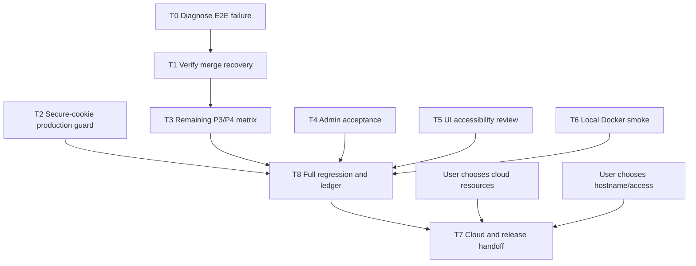

# Code Forge — remaining work breakdown

State date: 2026-10-25. Branch: `thviet`. Latest pushed code commit: `9c2eb81`; hosted run `40162474987` passed all workflow gates on that exact commit. Earlier runs `40159331450` and `40160123068` failed at backend E2E; their exact cause remains unknown. The 120-second reconciliation grace tests pass locally (unit 15/15; maintenance PostgreSQL E2E 2/2). This register decomposes the approved P0–P8 plan; it does not narrow or replace that scope. For a concise current acceptance board and task execution log, see `docs/operations/acceptance-task-board-2026-10-25.md` and `docs/operations/task-execution-log-2026-10-25.md`.

## Current verified state

- Full hosted workflow `40144424454` on `2955e36` passes; it includes all 7 backend E2E suites / 28 tests and the full frontend/Docker/migration gates.
- A docs-only commit `a5739cd` passed hosted workflow `40145063512`. Code commit `2305390` adds real-Git merge-conflict and AdminController restore E2E; hosted workflow `40145289400` passed all steps. Local backend lint/typecheck/unit (14 suites / 86 tests) pass; the E2E safety guard rejects the configured non-`*_test` DB before setup.
- Earlier authenticated logs for `40142759395`/`40143199809` identified double-read response and an incorrect assumption about internal journal fields in the detail API. `0403bda` fixed the test contract; `40143448486` passed.
- On `edb0ced`, local backend unit (15 suites/93 tests), full backend PostgreSQL/Git E2E (8 suites/29 tests), Prisma validate/generate, workspace lint/typecheck/build and diff check pass. E2E used a new volume-free PostgreSQL 17 container on a random loopback port; it was stopped and removed. Commit `298fb62` passes backend unit (15 suites/100 tests), targeted PostgreSQL/Git E2E (2 suites/5 tests), workspace lint/typecheck/build and `git diff --check` using another disposable loopback PostgreSQL 17 container. Jest itself returned exit 0; the surrounding PowerShell wrapper reported exit 1 after cleanup, so the wrapper-exit discrepancy is recorded rather than presented as a clean shell gate.
- Hosted merge recovery, same-operation concurrency, admin lock→session/PAT rejection, private-repository boundaries, audit-detail filtering, real-Git merge conflict invariants, and admin restore route success/audit pass in CI. Process-crash/quota/lifecycle cases remain open.
- Latest hosted run `40162474987` on `9c2eb81` passed all gates. Earlier backend E2E failures remain unexplained; inspect their authenticated logs only if historical root-cause analysis is needed. Current source enforces the 255-byte UTF-8 branch suffix limit and tests both 255-byte acceptance and 256-byte rejection; that finding is resolved in HEAD.
- A conservative operator triage runbook is drafted at `docs/operations/git-operation-recovery.md`. It deliberately does not prescribe raw SQL/ref repair; permanently ambiguous cross-type rows still need a supported reviewed resolution tool.
- Maintenance cleanup now includes `backend/test/maintenance-cleanup.e2e-spec.ts` with real PostgreSQL batch, retention-boundary, storage-removal, and repeated-run/idempotence assertions; abandoned Git temporary-directory cleanup is implemented. Abrupt-kill cleanup of an in-progress maintenance operation remains distinct from ordinary repeated-run coverage.
- Security audit found no confirmed exploitable vulnerability in reviewed PR/admin/lock paths, but found ordinary Git pushes have no durable attributable audit of actual ref changes. New issue [#5](https://github.com/VuLeCoder/Code-forge/issues/5) tracks a crash-safe journal, reconciliation, privacy, and acceptance matrix.
- Docker Engine responds. Do not reset existing containers/volumes. API and migration images were built on `edb0ced`; the migration image applied all 7 migrations to a fresh disposable DB, and API readiness returned 200. Later, an isolated unique Compose project applied all 7 migrations and returned readiness 200. Its containers/network were stopped without `-v`; only its test-owned volumes remain. A separate isolated test PostgreSQL container is still running for acceptance work; existing container `peaceful_chaplygin` was untouched.
- Latest public issue API check identifies issues #3 (PR/Git race/recovery), #4 (Docker/CI/cloud release), and #5 (durable Git push audit) as open. Existing update drafts are stale historical text and must be refreshed before posting; no comments were posted.

## Work packages

### T0 — Diagnose and repair the failing E2E workflow

- **Owner:** Codex lead + backend test agent; user may need to provide authenticated Actions logs.
- **Dependency:** Current hosted acceptance is green; historical diagnosis is optional and must not be inferred from run duration.
- **Writable scope:** `backend/test/*.e2e-spec.ts` and the smallest directly implicated backend source/test files.
- **Forbidden:** Existing dev/cloud database, secrets, broad refactors, unrelated UI or migration files.
- **Actions:** Root test-contract fixes are in `0403bda`; latest hosted run `40162474987` passes all workflow gates. Earlier runs `40159331450` and `40160123068` failed at backend E2E; their exact causes remain unknown and are not a blocker to current CI acceptance. Local backend E2E passes on isolated PostgreSQL. The 120-second grace regression passes its full maintenance E2E file (2/2).
- **Focused reproducer (once isolated PostgreSQL is available):** `corepack pnpm --filter backend exec jest --config test/jest-e2e.json --runInBand test/pull-requests.e2e-spec.ts -t "reconciles a Git-updated merge"` with loopback `*_test` database URLs and isolated `GIT_STORAGE_PATH`; then run the full E2E suite.
- **Acceptance:** Current hosted workflow acceptance is met on `9c2eb81`. Optional historical diagnosis: read the authenticated logs for the earlier failed runs and reproduce only if needed; preserve both green and historical red run evidence accurately.

### T1 — Accept merge ref-update / metadata-recovery path

- **Owner:** Codex lead + backend test agent.
- **Dependency:** T0 E2E access/failure resolved.
- **Files:** `backend/src/maintenance/maintenance-jobs.service.ts`, `backend/src/maintenance/maintenance-jobs.service.spec.ts`, `backend/test/pull-requests.e2e-spec.ts`.
- **Current changes:** Durable actor attribution, awaitable `runOnce`, unit coverage and an isolated PostgreSQL trigger that fails metadata after Git ref CAS.
- **Acceptance:** HTTP merge returns 202 after simulated DB failure; Git ref is a two-parent merge commit while PR metadata stays OPEN; reconciliation marks PR/operation complete with owner attribution and exactly one reconciliation audit; fetch sees the commit; retry with the same operation ID does not move the ref or add audit rows.

### T2 — Enforce production Secure cookies

- **Owner:** Codex lead; security reviewer verifies.
- **Dependency:** Independent of T0.
- **Files:** `backend/src/config/environment.ts`, `backend/src/config/environment.spec.ts`, security ledger.
- **Current changes:** Reject production configuration unless `COOKIE_SECURE=true`; local/test defaults remain false.
- **Acceptance:** Environment suite passes with production missing/false rejected and true accepted; local/test defaults remain valid; full CI passes.

### T3 — Close uncovered P3/P4 negative and recovery matrix

- **Owner:** Codex lead + backend test agent.
- **Dependency:** T0/T1 pass; first compare existing integration tests to avoid duplicate cases.
- **Writable scope:** Targeted backend repository/PR integration tests and smallest necessary backend implementation files.
- **Cases still to inventory:** conflict/no ref movement; stale source/target/version; source missing or storage generation reset; permission/state change before mutation; merge quota and branch-count limits; process crash around CAS/DB boundary; lock-loss/timeout cancellation; push/merge/delete/reset interactions not already covered.
- **Audit result:** Existing real PostgreSQL/Git E2E covers distinct-operation concurrent merges, push–merge, merge–soft-delete, DB metadata failure/reconciliation, same-operation replay, conflict/no-ref-movement, merge quota rejection without ref movement, storage-generation reset, and retry. Commit `298fb62` adds cross-type unresolved-merge fencing; `9c2eb81` includes the branch-byte-limit fix and integrated valid-pack lock-loss test. The valid-pack case passes on a disposable Linux runner 1/1, and hosted CI is green; Windows local E2E correctly skips this POSIX-only process test. A backend process-tree crash test remains unaccepted: after the API process exited, PostgreSQL retained an advisory-lock session beyond 60 seconds across the Windows host-to-Docker boundary. This does not yet distinguish product behavior from harness/network teardown. Cloud reset/recovery remains open.
- **Acceptance:** For each implemented case, isolated PostgreSQL/Git assertions prove whether Git refs and metadata moved, audit outcome, operation state, and retry behavior. No case is counted from mock-only tests when the plan requires real Git/database behavior.

### T4 — Finish P6 admin and maintenance acceptance

- **Owner:** Codex backend + admin UI agent; security reviewer audits.
- **Dependency:** Existing contracts remain unchanged unless a separately approved contract edit is needed.
- **Files:** Admin/auth/maintenance tests first; UI agent owns only `frontend/src/app/admin/page.tsx`, `frontend/src/app/admin/admin.module.css`, and `frontend/test/admin.spec.ts` if UI changes are required.
- **Acceptance:** Isolated integration proves locked user session/PAT rejection, public repository anonymous reads still work, admin cannot read private source or merge, last active admin cannot be locked, restore retention works, and audit omits secrets/source. Maintenance jobs remain batch/idempotent after repeated startup/run.
- **Progress:** Hosted DB-backed bootstrap create/promote is verified in `40136064222`; `40144424454` verifies AdminController lock/unlock, old session revoked, valid PAT Git request 200→401 after lock, non-member admin private source/PR/merge denial without ref movement, and audit API secret filtering. Unit/browser coverage includes final-admin/self-lock, expired restore behavior, audit allowlist, admin status UI and keyboard/focus.
- **Acceptance gap:** DB-backed AdminController restore/source-reset disclosure, durable Git push journal/audit, session/admin-lock serialization, and maintenance multi-batch/retention/idempotence coverage are present. Issue #5's conservative triage runbook is drafted, but a supported resolution tool for permanently ambiguous journals remains missing. Sleeping-service timing, abrupt-kill cleanup, and upgrade-from-production snapshot remain to verify.

### T5 — Accessibility and responsive review for existing PR/admin UI

- **Owner:** AGY (after the bounded handoff is committed) + Codex reviewer.
- **Dependency:** No API/route/auth/schema changes. Confirm whether code changes are needed after read-only review.
- **Candidate AGY-owned paths:** PR list/detail components and their CSS module plus frontend UI tests; admin page/CSS only in a separate task. AGY must not edit backend, API proxy routes, global auth, shared contracts, or migration files.
- **Acceptance:** Keyboard-only flow, visible focus, semantic names/roles, state announcements for merge/reconciliation, 375px and desktop layouts, browser tests, lint/typecheck. Report any screen-reader limitations and manual checks still outstanding.
- **Progress:** Commit `851013e` fixes empty-state trigger focus restoration and distinguishes/retries branch-fetch failures. Commit `141f749` adds Admin role/status actions and confirmation dialog focus/keyboard assertions. Commit `6c921e5` adds the background-reconciliation announcement test. Latest hosted workflow `40162474987` passed all frontend/browser gates on the exact release candidate. Screen-reader/manual device review remains open; AGY UI review attempts did not yield usable output.
- **AGY review:** Earlier bounded UI reviews timed out. The committed accessibility handoff was attempted through collaboration, but the bridge timed out after 300 seconds; a subsequent async task failed while loading an invalid Postman MCP schema; the final direct CLI attempt returned partial lint/Playwright progress at its 120-second print timeout and made no changes. The original collaboration worktree and caller-created worktree are clean and preserved for inspection. No persistent allow-rule, wildcard, global bypass or Windows/Antigravity setting was changed. `scripts/agy.ps1` pins direct CLI calls to `gemini-3.8-flash-medium`; the Codex AGY bridge has no model argument.

### T6 — Local Docker runtime smoke

- **Owner:** Codex.
- **Dependency:** Docker Engine responds promptly to `docker info` and `docker ps` (verified); isolated PostgreSQL/Git E2E, API/migration image runtime smoke, and fresh-database migration are verified on `edb0ced`. `298fb62` fixes the local Compose production/cookie mismatch. A unique-project runtime smoke subsequently applied all migrations and checked backend health/readiness; Compose has no frontend service, and a simultaneous `docker compose up` sequence was not separately rehearsed.
- **Forbidden:** Do not delete/reset containers or volumes or use an existing development database as a destructive fixture.
- **Acceptance:** Compose starts with loopback bindings; health checks pass; API image and migration job run; integration suite uses the dedicated `*_test` database/schema and isolated temporary Git root; teardown removes only test-owned resources. Unique-project Compose runtime smoke applied migrations 7/7 and backend readiness returned 200; maintenance cleanup E2E passed 2/2. Do not reset existing Compose volumes.

### T8 — Full regression and evidence ledger

- **Owner:** Codex lead + all task owners.
- **Dependency:** T0–T6 acceptance.
- **Files:** CI workflow and only required tests/source, `docs/implementation-status.md`, deployment docs.
- **Acceptance:** Frozen install, Prisma generate/migrate, backend unit and isolated PostgreSQL/Git E2E, workspace lint/typecheck/build, browser/full-stack, Docker API/migration image smoke, Compose validation and `git diff --check` passed in hosted run `40162474987` on `9c2eb81`; a unique-project Compose smoke independently applied 7/7 migrations and returned readiness 200. Full cloud acceptance remains outstanding. Ledger distinguishes historical failures from current green evidence and does not infer cloud acceptance.

### T7 — Cloud setup, Git transport, and release handoff

- **Owner:** User chooses authorized GitHub/Vercel/Render/Neon projects and demo hostname/access; Codex executes smoke after identifiers/interactive account access are available.
- **Dependency:** T8 acceptance and T6 or equivalent hosted runtime smoke; user choices U2/U3 in `next-actions.md`.
- **Forbidden:** No secret values in chat, repo, logs, tickets, or URL. No production-like database migration without known ownership and a backup rehearsal.
- **Acceptance:** Rehearse metadata backup and restore, additive/forward-only migration on a production-like copy, app rollback, and migration-failure recovery without resetting existing data. Then complete `docs/deployment/cloud-smoke-checklist.md` on the release commit, including Render-direct Git (>4.5 MB), PAT, private/public permission, cold start, source reset warning, recovery from a local clone, auth, PR merge, admin/audit, and proxy-header spoofing. Publish only after U4 review.

## Dependency graph

## Team and review contract

- Codex lead owns shared API contracts, schema/migrations, auth/policy, Git/storage coordination, reconciliation, release, and final integration.
- Up to four independent agents may work in parallel, one bounded task each; use separate worktrees for any concurrent edits. No overlapping file ownership.
- Each task has one initial dispatch and at most two evidence-based corrections. Timeout/unknown retains the task state and is never treated as success.
- AGY work begins only after the user-facing AGY mode/count checkpoint, committed handoff plan, exact worktree and mutually exclusive paths. Permission bypass stays false unless the user explicitly authorizes that exact trusted worktree/task.
- Security review is read-only unless Codex separately authorizes a specific fix; findings carry exact evidence and deployment caveats.
- Every completed package records commit, command output, CI run and residual limits in `docs/implementation-status.md`; updates to existing issues #3/#4 are prepared in `docs/issue-update-drafts.md` and posted only after live state/session is verified.
