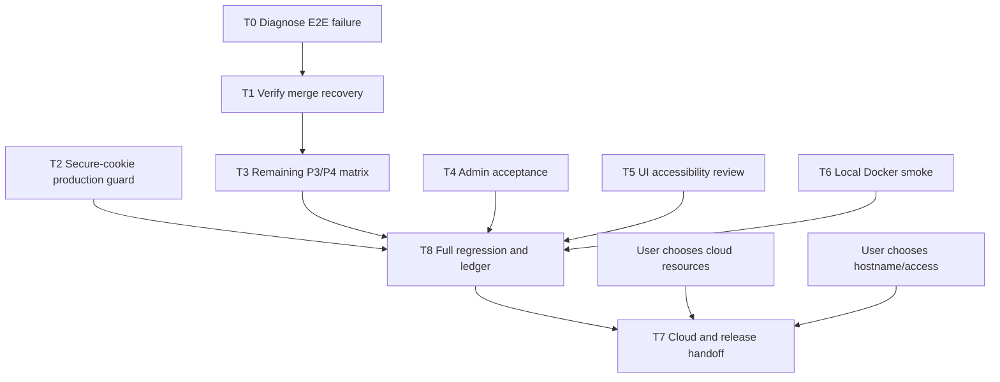

# Code Forge — remaining work breakdown

State date: 2026-10-25. Branch: `thviet`. Latest pushed code commit: `2955e36` (same-operation merge and admin HTTP E2E); latest backend runtime hardening remains `1227730`. This register decomposes the approved P0–P8 plan; it does not narrow or replace that scope.

## Current verified state

- Full hosted workflow `40144424454` on `2955e36` passes; it includes all 7 backend E2E suites / 28 tests and the full frontend/Docker/migration gates.
- Earlier authenticated logs for `40142759395`/`40143199809` identified double-read response and an incorrect assumption about internal journal fields in the detail API. `0403bda` fixed the test contract; `40143448486` passed.
- Local backend unit (14 suites/86 tests), lint/typecheck, frontend lint/typecheck and Playwright (49/49) pass. Local Docker Engine/PostgreSQL remains unavailable; local E2E is not established.
- Hosted merge recovery, same-operation concurrency, admin lock→session/PAT rejection, private-repository boundaries, and audit-detail filtering pass. Broader conflict/process-crash/quota/lifecycle cases remain open.
- Docker Desktop process is open, but Docker Engine commands do not return promptly and PostgreSQL `localhost:5433` is unavailable; do not reset containers or volumes. Local image/PostgreSQL smoke remains unverified.
- Public issue pages identify issues #3 (PR/Git race/recovery) and #4 (Docker/CI/cloud release) as open at the time checked. Drafts are updated with current CI evidence; only post to the existing issues after the owner chooses which comments to publish.

## Work packages

### T0 — Diagnose and repair the failing E2E workflow

- **Owner:** Codex lead + backend test agent; user may need to provide authenticated Actions logs.
- **Dependency:** Start here; do not infer the failing case from run duration.
- **Writable scope:** `backend/test/*.e2e-spec.ts` and the smallest directly implicated backend source/test files.
- **Forbidden:** Existing dev/cloud database, secrets, broad refactors, unrelated UI or migration files.
- **Actions:** Root test-contract fixes are in `0403bda`; the current full hosted workflow `40144424454` passed on `2955e36`, including new isolated PostgreSQL/Git E2E. Continue uncovered P3/P4 race/recovery matrix. The local focused E2E remains unavailable because PostgreSQL on `127.0.0.1:5433` is not listening.
- **Focused reproducer (once isolated PostgreSQL is available):** `corepack pnpm --filter backend exec jest --config test/jest-e2e.json --runInBand test/pull-requests.e2e-spec.ts -t "reconciles a Git-updated merge"` with loopback `*_test` database URLs and isolated `GIT_STORAGE_PATH`; then run the full E2E suite.
- **Acceptance:** Exact failing cases and causes recorded; hosted backend E2E passes against isolated test PostgreSQL and temporary Git storage on `2955e36` in `40144424454`; `git diff --check` passes. Local reproduction remains unavailable because local PostgreSQL is not listening.

### T1 — Accept merge ref-update / metadata-recovery path

- **Owner:** Codex lead + backend test agent.
- **Dependency:** T0 E2E access/failure resolved.
- **Files:** `backend/src/maintenance/maintenance-jobs.service.ts`, `backend/src/maintenance/maintenance-jobs.service.spec.ts`, `backend/test/pull-requests.e2e-spec.ts`.
- **Current changes:** Durable actor attribution, awaitable `runOnce`, unit coverage and an isolated PostgreSQL trigger that fails metadata after Git ref CAS.
- **Acceptance:** HTTP merge returns 202 after simulated DB failure; Git ref is a two-parent merge commit while PR metadata stays OPEN; reconciliation marks PR/operation complete with owner attribution and exactly one reconciliation audit; fetch sees the commit; retry with the same operation ID does not move the ref or add audit rows.

### T2 — Enforce production Secure cookies

- **Owner:** Codex lead; security reviewer verifies.
- **Dependency:** Independent of T0.
- **Files:** `backend/src/config/environment.ts`, `backend/src/config/environment.spec.ts`, security ledger.
- **Current changes:** Reject production configuration unless `COOKIE_SECURE=true`; local/test defaults remain false.
- **Acceptance:** Environment suite passes with production missing/false rejected and true accepted; local/test defaults remain valid; full CI passes.

### T3 — Close uncovered P3/P4 negative and recovery matrix

- **Owner:** Codex lead + backend test agent.
- **Dependency:** T0/T1 pass; first compare existing integration tests to avoid duplicate cases.
- **Writable scope:** Targeted backend repository/PR integration tests and smallest necessary backend implementation files.
- **Cases still to inventory:** conflict/no ref movement; stale source/target/version; source missing or storage generation reset; permission/state change before mutation; merge quota and branch-count limits; process crash around CAS/DB boundary; lock-loss/timeout cancellation; push/merge/delete/reset interactions not already covered.
- **Audit result (2026-10-25):** Existing real PostgreSQL/Git E2E covers distinct-operation concurrent merges, push–merge, merge–soft-delete, DB metadata failure/reconciliation and sequential idempotent retry. `2955e36` adds and `40144424454` verifies same-operation concurrent replay with one ref advancement/journal/audit. Service/unit tests cover conflict/quota rejection without CAS, but not combined HTTP+real-Git+DB invariants. End-to-end source reset/missing branch, lock-loss cancellation and abrupt process-kill remain gaps.
- **Acceptance:** For each implemented case, isolated PostgreSQL/Git assertions prove whether Git refs and metadata moved, audit outcome, operation state, and retry behavior. No case is counted from mock-only tests when the plan requires real Git/database behavior.

### T4 — Finish P6 admin and maintenance acceptance

- **Owner:** Codex backend + admin UI agent; security reviewer audits.
- **Dependency:** Existing contracts remain unchanged unless a separately approved contract edit is needed.
- **Files:** Admin/auth/maintenance tests first; UI agent owns only `frontend/src/app/admin/page.tsx`, `frontend/src/app/admin/admin.module.css`, and `frontend/test/admin.spec.ts` if UI changes are required.
- **Acceptance:** Isolated integration proves locked user session/PAT rejection, public repository anonymous reads still work, admin cannot read private source or merge, last active admin cannot be locked, restore retention works, and audit omits secrets/source. Maintenance jobs remain batch/idempotent after repeated startup/run.
- **Progress:** Hosted DB-backed bootstrap create/promote is verified in `40136064222`; `40144424454` verifies AdminController lock/unlock, old session revoked, valid PAT Git request 200→401 after lock, non-member admin private source/PR/merge denial without ref movement, and audit API secret filtering. Unit/browser coverage includes final-admin/self-lock, expired restore behavior, audit allowlist, admin status UI and keyboard/focus.
- **Acceptance gap:** Admin restore route success/audit and source reset disclosure have no DB-backed AdminController E2E; job batch/idempotence and sleeping-service timing remain to verify.

### T5 — Accessibility and responsive review for existing PR/admin UI

- **Owner:** AGY (after the bounded handoff is committed) + Codex reviewer.
- **Dependency:** No API/route/auth/schema changes. Confirm whether code changes are needed after read-only review.
- **Candidate AGY-owned paths:** PR list/detail components and their CSS module plus frontend UI tests; admin page/CSS only in a separate task. AGY must not edit backend, API proxy routes, global auth, shared contracts, or migration files.
- **Acceptance:** Keyboard-only flow, visible focus, semantic names/roles, state announcements for merge/reconciliation, 375px and desktop layouts, browser tests, lint/typecheck. Report any screen-reader limitations and manual checks still outstanding.
- **Progress:** Commit `851013e` fixes empty-state trigger focus restoration and distinguishes/retries branch-fetch failures. Commit `141f749` adds Admin role/status actions and confirmation dialog focus/keyboard assertions. Local lint/typecheck and Playwright pass (49/49); hosted browser/full-stack gates pass in `40144424454`. Screen-reader/manual multi-viewport review remains open.
- **AGY review:** A bounded read-only review of the admin UI and deploy-origin guidance timed out at 60 seconds with no usable result; no AGY approval is claimed.

### T6 — Local Docker runtime smoke

- **Owner:** User starts/recover Docker Desktop; Codex performs the project-scoped checks afterward.
- **Dependency:** Docker Engine responds promptly to `docker info` and `docker ps`.
- **Forbidden:** Do not delete/reset containers or volumes or use an existing development database as a destructive fixture.
- **Acceptance:** Compose starts with loopback bindings; health checks pass; API image and migration job run; integration suite uses the dedicated `*_test` database/schema and isolated temporary Git root; teardown removes only test-owned resources.

### T8 — Full regression and evidence ledger

- **Owner:** Codex lead + all task owners.
- **Dependency:** T0–T6 acceptance.
- **Files:** CI workflow and only required tests/source, `docs/implementation-status.md`, deployment docs.
- **Acceptance:** Frozen install, Prisma generate/migrate, backend unit and isolated PostgreSQL/Git E2E, workspace lint/typecheck/build, browser/full-stack, Docker API/migration image smoke, Compose validation and `git diff --check` all pass on one identified release commit. Ledger distinguishes previous green runs from latest attempts and does not infer cloud acceptance.

### T7 — Cloud setup, Git transport, and release handoff

- **Owner:** User chooses authorized GitHub/Vercel/Render/Neon projects and demo hostname/access; Codex executes smoke after identifiers/interactive account access are available.
- **Dependency:** T8 acceptance and T6 or equivalent hosted runtime smoke; user choices U2/U3 in `next-actions.md`.
- **Forbidden:** No secret values in chat, repo, logs, tickets, or URL. No production-like database migration without known ownership and a backup rehearsal.
- **Acceptance:** Rehearse metadata backup and restore, additive/forward-only migration on a production-like copy, app rollback, and migration-failure recovery without resetting existing data. Then complete `docs/deployment/cloud-smoke-checklist.md` on the release commit, including Render-direct Git (>4.5 MB), PAT, private/public permission, cold start, source reset warning, recovery from a local clone, auth, PR merge, admin/audit, and proxy-header spoofing. Publish only after U4 review.

## Dependency graph

## Team and review contract

- Codex lead owns shared API contracts, schema/migrations, auth/policy, Git/storage coordination, reconciliation, release, and final integration.
- Up to four independent agents may work in parallel, one bounded task each; use separate worktrees for any concurrent edits. No overlapping file ownership.
- Each task has one initial dispatch and at most two evidence-based corrections. Timeout/unknown retains the task state and is never treated as success.
- AGY work begins only after the user-facing AGY mode/count checkpoint, committed handoff plan, exact worktree and mutually exclusive paths. Permission bypass stays false unless the user explicitly authorizes that exact trusted worktree/task.
- Security review is read-only unless Codex separately authorizes a specific fix; findings carry exact evidence and deployment caveats.
- Every completed package records commit, command output, CI run and residual limits in `docs/implementation-status.md`; updates to existing issues #3/#4 are prepared in `docs/issue-update-drafts.md` and posted only after live state/session is verified.
