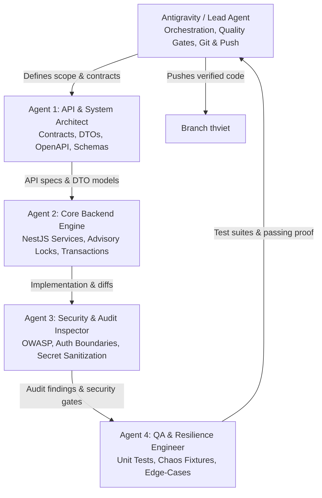
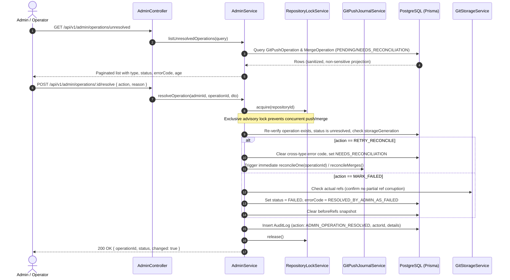

# Code Forge — Backend System Design & Multi-Agent Execution Plan

## 1. Executive Summary & Objective

This document establishes the architecture, API contracts, database transaction guarantees, and execution breakdown for completing the backend of **Code Forge MVP**. In accordance with owner directives, **frontend/Vercel work is deferred**, focusing strictly on backend resilience, data safety, fail-closed reconciliation, and operator tooling.

---

## 2. Multi-Agent Team Structure (5-Agent Organization)

### Roles and Bounded Ownership
| Role | Primary Responsibility | Scope / Tools |
| :--- | :--- | :--- |
| **Lead Agent (Antigravity)** | Điều phối luồng, quản lý context, chạy gates (`lint/typecheck/test`), commit và push lên `thviet`. | Root project, `scripts/`, Git CLI. |
| **Agent 1: API & System Architect** | Thiết kế contract, DTOs, error codes, phân tích database boundary theo chuẩn `api-and-interface-design`. | `backend/src/admin/admin.dto.ts`, interfaces. |
| **Agent 2: Core Backend Implementer** | Lập trình các service, xử lý advisory lock, transaction atomicity, reconciliation logic. | `backend/src/admin/admin.service.ts`, `backend/src/repositories/...` |
| **Agent 3: Security & Audit Inspector** | Review diff độc lập, kiểm tra rò rỉ secret, bypass quyền, idempotency và audit completeness. | Code review, security checklists. |
| **Agent 4: QA & Resilience Engineer** | Viết unit/integration test, kiểm thử failure matrix, negative assertions, edge cases. | `*.spec.ts`, `backend/test/*.e2e-spec.ts`. |

---

## 3. System Architecture: Ambiguous Git Journal Resolution (Issue #6)

### 3.1 The Problem
When Git push operations or PR merge operations encounter unexpected crashes or network interruptions, they enter `PENDING` or `NEEDS_RECONCILIATION`. If automatic reconciliation cannot verify the outcome (e.g. `CROSS_TYPE_OPERATION_UNRESOLVED`, `REF_OUTCOME_UNKNOWN`), the repository write lock is held fail-closed forever. Currently, no operator API exists to inspect or resolve these rows.

### 3.2 Solution Architecture

### 3.3 Security & Boundary Invariants
1. **Never delete journal rows**: Historical evidence must be permanent.
2. **Never roll back Git refs automatically**: Git refs are the source of truth; if refs moved, the operation must be completed or marked accordingly, never rolled back.
3. **Data isolation / No secret leakage**: `beforeRefs` or raw commit messages are never exposed in audit logs or admin APIs. Only safe metadata (`operationId`, `repositoryId`, `errorCode`, `status`, `actorId`, `timestamps`) is projected.
4. **Advisory lock serialization**: All resolution actions acquire the repository advisory lock first.

---

## 4. Backend Work Packages Breakdown

### Package B1: Ambiguous Journal Resolution API & Logic (Issue #6)
* **Files**:
  - `backend/src/admin/admin.dto.ts` (Add `AdminUnresolvedQueryDto`, `AdminResolveOperationDto`)
  - `backend/src/admin/admin.controller.ts` (Add routes: `GET /operations/unresolved`, `GET /operations/:id`, `POST /operations/:id/resolve`)
  - `backend/src/admin/admin.service.ts` (Implement listing, detail inspection, and atomic resolution under lock)
  - `backend/src/admin/admin.service.spec.ts` (Unit test suite with full coverage of conflict, lock release, audit creation, and state transitions)

### Package B2: Stale PR Merge & Conflict Invariants (P3/P4)
* **Files**:
  - `backend/src/repositories/pull-requests.service.ts`
  - `backend/src/repositories/pull-requests.service.spec.ts`
  - Invariants: Abort merge with 409 Conflict if source branch was deleted, or if target branch advanced beyond expected commit before merge CAS.

### Package B3: Maintenance & Cleaners Hardening (P6)
* **Files**:
  - `backend/src/maintenance/maintenance-jobs.service.ts`
  - `backend/src/maintenance/maintenance-jobs.service.spec.ts`
  - Safeguard against unhandled exceptions during background file scanning.

---

## 5. Verification Gate Ladder
Every package must pass sequentially:
1. `corepack pnpm --filter backend lint`
2. `corepack pnpm --filter backend typecheck`
3. `corepack pnpm --filter backend test` (Unit tests)
4. Independent code review for regression and security boundaries.
5. Atomic Git commit on `thviet` and push.
