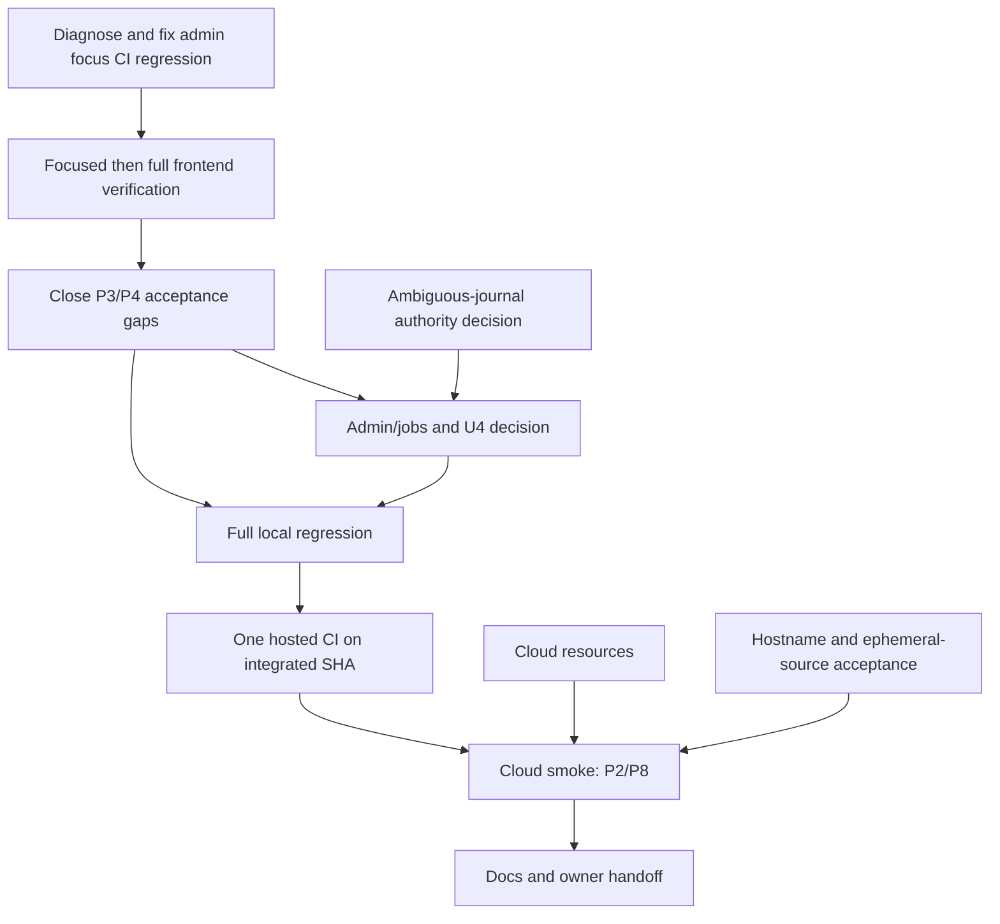

# Code Forge: completion and release plan

## Current verified state (2026-10-26; older snapshots below are history)

- `origin/thviet` is at `de764470e92f1fbbb9a32c2ab907fd114f77e5ae` (`de76447`); the current review worktree is `codex/pr-operation-id-reuse` at the same base. Code commit `b6411ad` passed hosted Actions [#118 / `40262580445`](https://github.com/VuLeCoder/Code-forge/actions/runs/40262580445), and docs reconciliation commit `de76447` passed Actions #120. A local duplicate-OPEN-PR E2E assertion passes on isolated PostgreSQL; hosted CI for this candidate is not yet recorded.
- Merge→delete ordering is now deterministic and verified: PostgreSQL confirms DELETE queued on the repository advisory lock while merge pauses before ref CAS; merge commit, journal, PR metadata and audit complete before soft-delete. The full PR E2E file passed 14 runnable / 2 intentional skips; #118 passed the full CI workflow.
- Render serves `388c584`; readiness 200 is not migration, backup/restore, direct Git, or business smoke. Historical P1001 root cause remains unknown. Do not deploy/restart before Git source recovery is verified.
- P0–P8 are not complete. P2/P8 and other P3/P4 cases remain open; recent read-only audits also found uncovered restore-vs-purge concurrency (P3) and scheduled temp-directory cleanup wiring (P6). Issue #6 stays fail-closed pending owner policy; Vercel is deferred/out of scope.

The estimates, dates, and state records below are retained as historical planning context; do not use them as current status.

**Plan origin:** 2026-10-25 14:02 Asia/Saigon (historical estimate; see current execution snapshot above).
**Branch / pushed SHA at plan creation (historical):** `thviet` / `25487b5` (`origin/thviet` matched then).
**Scope:** finish the already user-approved P0–P8 MVP plan; no new product scope.

## Historical status snapshot (2026-10-25)

- `thviet` and `origin/thviet` are at `25487b5`. The squash commit `e2b5a1a` is on `origin/main`; hosted run `40180253512` failed on the narrow admin focus-return test (55 passed, 1 failed). Backend, lint, typecheck, and build jobs passed. Treat the frontend regression as open; do not count the workflow as passed.
- Local workspace lint, typecheck, and build passed; backend unit passed 18 suites / 120 tests. Backend E2E reported 9 suites / 38 passed / 2 skipped, but Jest stayed alive after an open-handle warning and was interrupted. The test results are observed, but this invocation did not exit cleanly and is not a clean gate pass.
- The admin focus fix is complete on `thviet`: hosted run #77 (`40178590940`) passed all workflow gates on exact SHA `25487b5c99603e09254c2b5a6e30d358193dad01`. Earlier failures #69 (`40170013908`) and #70 (`40170763221`) are historical failures on older SHAs; retain them as history, not as current status.
- The local demo is running with a local-only database and storage. Render deployment remains unresolved with Prisma `P1001` at startup. Vercel's GitHub App connection is still dependent on the personal repository owner granting/installing access; no Vercel deploy is verified.
- P3/P4 interaction-matrix gaps and P6 operational/owner-decision gaps remain. Cloud acceptance is not complete. These local and hosted-code results do not establish cloud success or durable source storage.

## Estimate and completion target

The original estimate was **13–21 focused hours**, plus hosted CI wait time (then estimated at about 5–7 minutes per full run) and cloud-provider setup/propagation. This remains an estimate from the planning snapshot, not a measured remaining-duration guarantee. The calendar targets below are likewise the original forecast, not a current completion promise. With three parallel workers plus the lead, the original forecast was:

- **Local + hosted-code acceptance:** 2026-10-27 to 2026-10-28.
- **Cloud demo smoke and handoff:** 2026-10-29 to 2026-10-30, only if the owner supplies the cloud-resource/hostname decisions by 2026-10-26 and accepts the documented ephemeral Git-source limitation.

Confidence is medium for local/CI and low-to-medium for cloud. If U2/U3/U4 below remain unanswered, cloud release or the audited ambiguous-journal workflow is blocked; dates must move rather than silently weakening acceptance. This is a forecast, not a completion claim.

## Workflow changes to reduce wasted checking

1. For a failing run, inspect the first failed step and exact test/log before any retry. Fix the cause, run only the focused reproducer, then one relevant suite.
2. Run tests in a gate ladder: changed-module lint/typecheck → focused unit/browser/E2E → full local regression after 2–3 slices → one hosted CI for the integrated SHA. Do not run concurrent commands that share `.next`.
3. Keep each agent slice to 3–5 files, one owner per file set, explicit acceptance commands, and a report containing exact counts/output. The current tool allows four concurrent participants total including the lead, so the practical team is the lead plus three agents, not four agents plus the lead.
4. Start with backend/API contracts, then UI against the fixed contract; parallelize docs and read-only review only when they do not edit those files.
5. Time-box independent audits. A timeout is “no result”; switch model only for a bounded, narrower task and never count the timeout as a pass.
6. Update the evidence ledger after each integrated commit. Keep documentation-only local changes separate from code acceptance until reviewed; never stage `AGENTS.md` accidentally.

## Work breakdown and dependencies

### T0 — Diagnose and fix admin focus CI regression

**Owner:** frontend agent in isolated worktree; Codex reviews/integrates. **Estimate:** 0.5–1.5 h.
**Skills:** `frontend-ui-engineering`, `ui-ux-pro-max`, `ui-styling`, `test-driven-development`.

- [x] Historical failure #70 on `41c23ec`: frontend Playwright failed 53/55; desktop and narrow focus-return tests failed after Escape.
- [x] Preserve the test contract: focus returns to the connected opener; if removed, focus falls back to the admin heading.
- [x] Implement the focus restoration fix on `thviet` and verify it in the subsequent frontend tests and hosted workflow #77 on exact SHA `25487b5`.

**Status:** complete for the admin focus regression. Historical failure evidence remains in the record. This does not resolve unrelated cloud or P3/P4 gaps.

### T0b — Frontend regression checkpoint

**Owner:** Codex QA lead. **Estimate:** 0.5–1 h.
**Skills:** `browser-testing-with-devtools`, `debugging-and-error-recovery`.

- [x] Frontend browser suite, lint/typecheck/build, and hosted workflow passed on `25487b5`; run #77 (`40178590940`) completed successfully on the exact branch SHA.
- [ ] Fix and verify the narrow admin focus-return regression from hosted run `40180253512` on squash commit `e2b5a1a`; do not infer its outcome from the green `thviet` run.

**Status:** branch `thviet` checkpoint complete; `origin/main` squash-run checkpoint remains pending at last observation.

### T1 — Close P3/P4 Git and PR acceptance gaps

**Owner:** backend/Git agent; Codex owns final contract and integration. **Estimate:** 4–7 h.
**Skills:** `api-and-interface-design`, `test-driven-development`, `security-and-hardening`; read-only reviewer: `security-auditor`.

- [ ] Inventory existing real PostgreSQL/Git coverage before adding tests; close only uncovered permission-change, stale-ref/version, storage-generation reset, and push/merge/delete/reset interactions.
- [ ] Verify paginated summary/commits/files/diff remains one snapshot, stale requests return 409, and no response leaks private repository data.
- [ ] Confirm merge conflict/stale/lock-loss outcomes leave refs and metadata consistent; use isolated test schema and temporary Git root.

**Acceptance:** focused real-DB/Git cases plus PR E2E pass; each prohibited mutation proves refs unchanged; no duplicate coverage added without a gap.

### T2 — Close P6 admin and maintenance owner-dependent work

**Owner:** Codex backend + admin agent after contract. **Estimate:** 2–4 h after U4.
**Skills:** backend: `security-and-hardening`, `test-driven-development`; UI: `frontend-ui-engineering`, `ui-ux-pro-max`, `ui-styling`; reviewer: `security-auditor`.

- [ ] Reconcile remaining admin restore/session-lock/job idempotence gaps against the acceptance board.
- [ ] Before building ambiguous-journal resolution, obtain U4: which authority (ADMIN or operator role) and one-person or two-person approval. Until answered, keep fail-closed behavior and the runbook.
- [ ] Ensure audit excludes secrets/source and records actual Git outcomes, not merely HTTP success.

**Acceptance:** isolated PostgreSQL tests cover the approved authority, repeat-safe jobs, locked-user behavior, restore, and audit privacy. No manual SQL/ref repair.

### T3 — Integrated regression checkpoint

**Owner:** Codex QA lead; agents may own independent test suites. **Estimate:** 2–3 h + test runtime.
**Skills:** `code-review-and-quality`, `browser-testing-with-devtools`, `test-driven-development`.

- [ ] Run backend unit/E2E, frontend browser suite, full-stack journey, lint/typecheck/build, Docker image smoke, and `git diff --check` once on the integrated candidate. Latest local workspace lint/typecheck/build pass and backend unit passes 18 suites / 120 tests. Backend E2E reported 9 suites / 38 passed / 2 skipped, but Jest did not exit after its open-handle warning and was interrupted; rerun/diagnose before calling this gate clean.
- [ ] If one gate fails, inspect exact logs and rerun only its focused reproducer before another whole gate.
- [ ] Cover owner → collaborator → push → PR compare → owner merge → fetch, plus admin lock/unlock/restore/audit.

**Acceptance:** all required gates green on the candidate commit; platform-specific skips are explicitly recorded, never counted as passes.

### T4 — Hosted CI gate

**Owner:** Codex release lead. **Estimate:** 0.25 h active + 5–7 min typical CI.
**Skills:** `ci-cd-and-automation`, `debugging-and-error-recovery`.

- [x] Hosted run #77 (`40178590940`) passed on exact SHA `25487b5c99603e09254c2b5a6e30d358193dad01` on `thviet`.
- [ ] Fix the admin focus-return failure in run `40180253512` for main squash `e2b5a1a`, then verify CI on the resulting commit.

**Status:** CI passed for `thviet` at `25487b5`; `origin/main` run `40180253512` failed on one narrow focus-return test and is open for repair.

### T5 — P2/P8 cloud demo and recovery smoke

**Owner:** Codex release lead + owner. **Estimate:** 4–8 h after U2/U3, plus provider delays.
**Skills:** `shipping-and-launch`, `browser-harness`, `security-and-hardening`.

- [x] Local demo is running with a local-only database/storage and a separate normal demo account. This is not cloud acceptance.
- [ ] Diagnose Render's unresolved Prisma `P1001` startup failure without blind redeploys or exposing connection strings.
- [ ] Diagnose Render/Neon connectivity and complete the cloud checks only after DB authentication and SQL operations are proven. Vercel GitHub App authorization is deferred/out of scope per the latest owner objective; it is not treated as completed or as a cloud gate.
- [ ] U3: choose hostname/audience and explicitly accept that free Render storage can lose Git source on sleep/restart/redeploy while metadata persists.
- [ ] Deploy additive migration safely; rehearse metadata backup/restore, application rollback, and failed-migration recovery.
- [ ] Smoke auth/private/public, PAT, direct Render HTTPS clone/fetch/push (including >4.5 MB), invitations, PR merge, admin/audit, cold start, source-loss warning, and restore from local clone.

**Historical status:** cloud acceptance remained open in this earlier snapshot. Its Vercel Git integration prerequisite is superseded: Vercel is deferred/out of scope. Current Render/Neon evidence is recorded at the top of this plan and in `docs/implementation-status.md`.

## Latest execution addendum — 2026-10-25

- Root branch `thviet` now includes local commit `af80826` for the corrected admin mobile accessibility presentation. Root gates passed: frontend lint/typecheck, the 4-test admin browser subset twice on the integrated tree, and `git diff --check`; viewports were 1280×800 and 375×812. This closes only T5-ADMIN-A11Y locally, not cloud release.
- Auth agent's test-only change is integrated as `b1c2c2a`; root reran the real-PostgreSQL AuthService concurrency test 1/1 and HTTP auth E2E 8/8 with loopback `*_test` URLs. No production code changed in this slice.
- PR agent test commits are integrated as `c380bac`, `52face3`, `22d94a5`, and `6c3a6c3`. Root focused real-PostgreSQL/Git reruns passed snapshot/staleness and unrelated-history `NO_MERGE_BASE` tests (2 passed, 10 intentionally skipped); independent review found no actionable issue.
- Maintenance 120-second grace test coverage was checked independently; unit coverage is 16/16 and the immediate `NEEDS_RECONCILIATION` E2E case already exists. No duplicate changes were made.
- The root worktree still contains other existing uncommitted test/documentation changes. Preserve them; do not push until the integrated candidate and required full regression are reviewed. Cloud P1001 remains unresolved.

### T6 — Documentation and handoff

**Owner:** docs agent; Codex verifies. **Estimate:** 1–2 h.
**Skills:** `documentation-and-adrs`, `code-review-and-quality`.

- [ ] Reconcile overview docs, acceptance board, task log, deployment/runbook, and API contract to exact release SHA.
- [ ] Record evidence, skipped tests, residual issues, limits, and operator restore steps.

**Acceptance:** a new operator can reproduce local setup and demo recovery; docs claims match CI/cloud evidence.

## Owner decisions required

- **U2:** confirm Render/Neon resource access. Vercel remains deferred/out of scope and is not considered resolved.
- **U3:** demo hostname/audience and acceptance of ephemeral Git-source storage.
- **U4:** authority and approval count for permanently ambiguous merge/push journals.

No secrets are requested in chat. These choices only gate the affected cloud/operator tasks; local implementation can proceed independently where safe.

## Execution addendum — latest verified state (2026-10-25)

This addendum supersedes older “current” snapshots above; historical run/commit records remain historical evidence.

- Local branch `thviet` is at `71a0c48541a34e6e7a057854b6b06ccbb79724eb`, 16 commits ahead of `origin/thviet` (`24e8d85effac0c511ca9a890eafe6385b154c1d7`). Do not push the unaccepted batch yet. Existing unrelated user documentation/config changes remain in the worktree and must be preserved.
- Integrated backend gates on this candidate: unit 19 suites / 156 tests passed; backend typecheck, lint, build and `git diff --check` passed.
- Auth logout/refresh security fix is in local commits `6d8c827` and `da020f9`, but the new concurrent PostgreSQL E2E remains unaccepted: 8/9 tests passed; refresh was observed queued behind the row lock, but logout did not appear as a second waiter and both handlers emitted sanitized errors. Independent review says the shared-pool waiter count cannot identify requests. A new test-only AuthService E2E with separately named PostgreSQL clients is in progress; the loopback/`_test` URL guard remains uncommitted in `E:\Prj1-worktrees\logout-refresh-family`.
- Storage-recovery E2E has the missing `defaultBranch: main` response/DB assertions in `71a0c48`; its real PostgreSQL/Git E2E has not yet been rerun after integration.
- Admin responsive AGY changes remain unaccepted: frontend lint/typecheck and browser tests pass 4/4 at 1280×800 and 375×812, but the narrow CSS hides table headers from assistive technology. User will manually send the corrective AGY prompt; Codex must not dispatch another AGY job without request.
- Backend work remains priority. Next gates: (1) finish the isolated AuthService concurrency E2E, then run it serially; (2) finish admin-bootstrap idempotence E2E; (3) run the storage recovery E2E serially on the dedicated loopback `*_test` database; (4) rerun full backend acceptance on the integrated candidate; (5) push only to `thviet` after required tests and review pass. Render/Neon P1001 diagnosis follows backend acceptance; ignore Vercel per owner plan.
